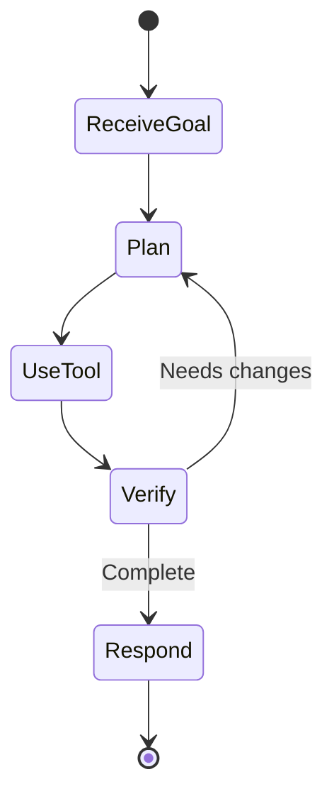

# AI Agents

> AI agents use a model to plan and invoke tools toward a bounded goal.

## Overview

A useful agent defines its tools, constraints, stopping conditions, and verification steps clearly. Agent autonomy should be proportional to the reversibility and risk of the operations it can perform.

## Example Flow

!!! warning
    Require authorization and confirmation for destructive or sensitive operations.
