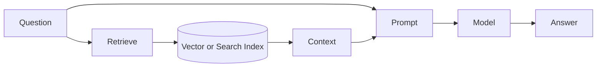

# Retrieval-Augmented Generation

> Retrieval-Augmented Generation combines relevant retrieved context with a language model response.

## Overview

RAG retrieves documents or passages related to a query and passes them as context to the model. This can reduce unsupported answers for private or frequently changing knowledge.

## Flow

## Considerations

- Measure retrieval quality independently.
- Preserve source attribution.
- Chunk documents according to semantic boundaries.
- Treat retrieved text as untrusted input.
