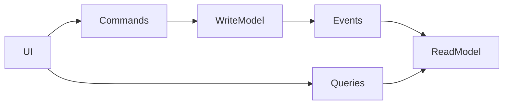

# CQRS

> Command Query Responsibility Segregation separates operations that change state from operations that read state.

## Overview

CQRS can simplify complex domains by giving write and read models independent responsibilities. It does not require separate databases or event sourcing, and it can add significant complexity.

## Example

