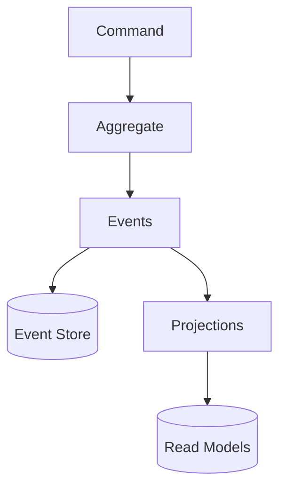

# Event Sourcing

> Event Sourcing persists state changes as an append-only sequence of domain events.

## Overview

Instead of storing only the latest entity state, an event-sourced system stores facts that explain how state changed. An aggregate can rebuild its state by replaying events.

## Example

```text
OrderCreated
PaymentApproved
ItemShipped
OrderCompleted
```

## Flow



## Benefits and Risks

Benefits include auditability and temporal reconstruction. Risks include schema evolution, replay complexity, and the need for projections and data retention strategies.
