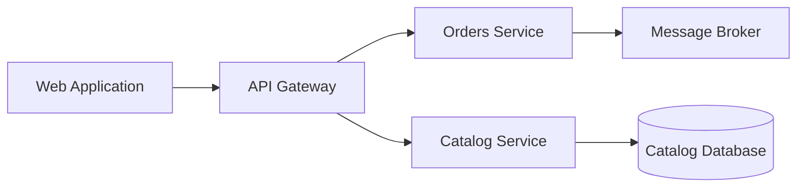

# Microservices

> Microservices organize a system as independently deployable business capabilities.

## Overview

A microservices architecture trades local simplicity for operational distribution. Teams should introduce service boundaries only when independent deployment or scaling provides measurable value.

## Diagram

## Considerations

- Define clear service ownership.
- Use API contracts and versioning.
- Prefer asynchronous integration for eventual workflows.
- Plan for observability, retries, idempotency, and failure isolation.
