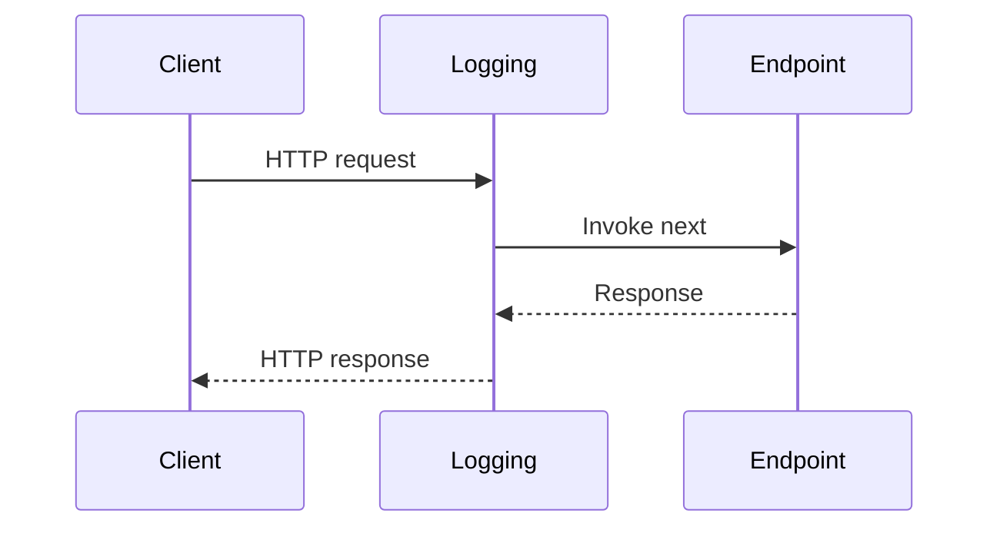

# Middleware

> ASP.NET Core middleware components process HTTP requests in a configured pipeline.

## Overview

Each middleware can perform work before and after the next component. Components can also short-circuit the pipeline and return a response.

## Example

```csharp
app.Use(async (context, next) =>
{
    Console.WriteLine($"Request: {context.Request.Path}");
    await next();
    Console.WriteLine($"Response: {context.Response.StatusCode}");
});
```

## Pipeline


