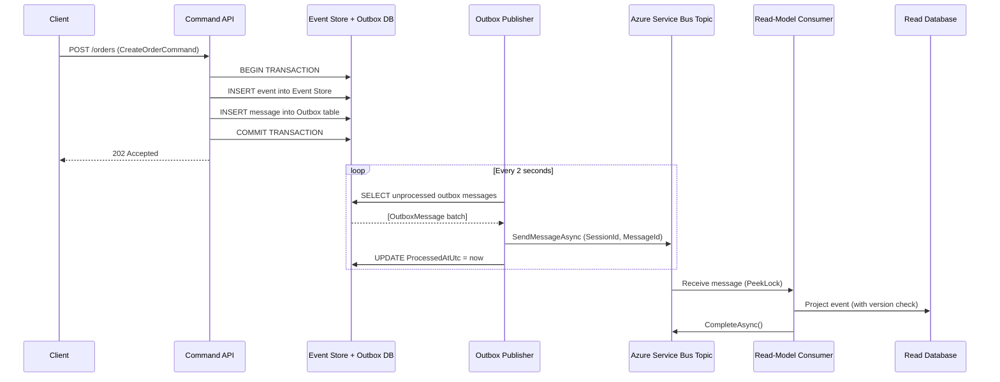

# Event-Driven .NET Microservice Architecture Guide

## CQRS, Event Sourcing & Azure Service Bus — From Theory to Production

A comprehensive reference for designing and building event-driven .NET microservices using the **Command Query Responsibility Segregation (CQRS)** pattern, **Event Sourcing**, and **Azure Service Bus (ASB)** as the messaging backbone. Covers foundational concepts, architectural principles, common pitfalls, and production-ready C# implementations.

---

## Table of Contents

- [1. Core Concepts](#1-core-concepts)
  - [1.1 Event-Driven Architecture](#11-event-driven-architecture)
  - [1.2 CQRS — Command Query Responsibility Segregation](#12-cqrs--command-query-responsibility-segregation)
  - [1.3 Event Sourcing](#13-event-sourcing)
  - [1.4 Azure Service Bus Fundamentals](#14-azure-service-bus-fundamentals)
  - [1.5 How They Fit Together](#15-how-they-fit-together)
- [2. Architecture Overview](#2-architecture-overview)
  - [2.1 End-to-End Data Flow](#21-end-to-end-data-flow)
  - [2.2 Component Responsibilities](#22-component-responsibilities)
- [3. Architectural Principles — Do's](#3-architectural-principles--dos)
  - [3.1 Implement the Transactional Outbox Pattern](#31-implement-the-transactional-outbox-pattern)
  - [3.2 Enforce Idempotency on Read-Model Consumers](#32-enforce-idempotency-on-read-model-consumers)
  - [3.3 Use ASB Sessions for Strict Per-Aggregate Ordering](#33-use-asb-sessions-for-strict-per-aggregate-ordering)
  - [3.4 Set Deterministic MessageId with Duplicate Detection](#34-set-deterministic-messageid-with-duplicate-detection)
  - [3.5 Use PeekLock Mode — Never ReceiveAndDelete](#35-use-peeklock-mode--never-receiveanddelete)
  - [3.6 Leverage Dead-Letter Queues for Poison Messages](#36-leverage-dead-letter-queues-for-poison-messages)
    - [3.6.1 How Upstream Knows a Message Was Dead-Lettered](#361-how-upstream-knows-a-message-was-dead-lettered)
    - [3.6.2 Resolving Dead-Lettered Messages](#362-resolving-dead-lettered-messages)
    - [3.6.3 End-to-End DLQ Flow for Mission-Critical Messages](#363-end-to-end-dlq-flow-for-mission-critical-messages)
- [4. Common Anti-Patterns — Don'ts](#4-common-anti-patterns--donts)
  - [4.1 Don't Use Service Bus as Your Event Store](#41-dont-use-service-bus-as-your-event-store)
  - [4.2 Don't Publish Commands to Topics](#42-dont-publish-commands-to-topics)
  - [4.3 Don't Leak Domain Events Across Boundaries](#43-dont-leak-domain-events-across-boundaries)
  - [4.4 Don't Rely on ASB Ordering Without Sessions](#44-dont-rely-on-asb-ordering-without-sessions)
  - [4.5 Don't Write Fat Event Payloads](#45-dont-write-fat-event-payloads)
- [5. C# Implementation — Transactional Outbox Pattern](#5-c-implementation--transactional-outbox-pattern)
  - [5.1 Outbox Entity & DbContext](#51-outbox-entity--dbcontext)
  - [5.2 Command Handler — Atomic Write](#52-command-handler--atomic-write)
  - [5.3 Background Publisher — Outbox to ASB](#53-background-publisher--outbox-to-asb)
- [6. C# Implementation — Idempotent Read-Model Consumer](#6-c-implementation--idempotent-read-model-consumer)
- [7. Operational Concerns](#7-operational-concerns)
  - [7.1 Monitoring & Observability](#71-monitoring--observability)
  - [7.2 Retry & Back-Pressure Strategy](#72-retry--back-pressure-strategy)
  - [7.3 Schema Evolution](#73-schema-evolution)
- [8. Quick Reference Checklist](#8-quick-reference-checklist)

---

## 1. Core Concepts

### 1.1 Event-Driven Architecture

In an event-driven architecture, services communicate by producing and reacting to **events** — immutable records of something that has already happened (e.g., `OrderCreated`, `PaymentProcessed`). This decouples producers from consumers: the service that emits an event doesn't know or care who consumes it.

Key benefits:
- **Loose coupling** — services evolve independently behind event contracts.
- **Temporal decoupling** — producers and consumers don't need to be online simultaneously.
- **Scalability** — consumers can be scaled independently based on their own throughput needs.
- **Auditability** — events form a natural, append-only audit log.

### 1.2 CQRS — Command Query Responsibility Segregation

CQRS separates the **write model** (Commands) from the **read model** (Queries) into two distinct paths:

```
┌──────────────┐          ┌──────────────┐
│  Command API │          │  Query API   │
│  (Write)     │          │  (Read)      │
└──────┬───────┘          └──────┬───────┘
       │                         │
       ▼                         ▼
┌──────────────┐          ┌──────────────┐
│  Event Store │──events──▶│  Read DB     │
│  (Source of  │          │  (Projections,│
│   Truth)     │          │   Denormalized│
└──────────────┘          │   Views)     │
                          └──────────────┘
```

- **Commands** represent an *intent* to change state (e.g., `CreateOrder`, `CancelPayment`). They target a single aggregate and may be accepted or rejected.
- **Queries** read from purpose-built, denormalized projections optimized for specific UI or API needs.

**Why use CQRS?** Traditional CRUD models force a single data model to serve both reads and writes, creating tension between write-side invariants and read-side performance. CQRS eliminates this by letting each side evolve independently — the write side can enforce complex business rules while the read side uses denormalized views tailored to query patterns.

### 1.3 Event Sourcing

Instead of storing current state, Event Sourcing stores every state-changing **event** in an append-only log. The current state of an aggregate is derived by replaying its event stream:

```
Events for Order-123:
  v1: OrderCreated   { customerId: "C-55", amount: 250.00 }
  v2: ItemAdded      { sku: "WIDGET-A", qty: 2 }
  v3: PaymentApplied { method: "CreditCard", amount: 250.00 }
  v4: OrderShipped   { trackingId: "TRK-987" }

Current State = replay(v1 → v4)
```

**Key properties:**
- **Immutability** — events are never updated or deleted; they represent historical facts.
- **Full auditability** — you can reconstruct the state of any aggregate at any point in time.
- **Temporal queries** — "What was this order's state on Tuesday?" becomes trivial.
- **Rebuild projections** — if a read model is corrupted or a new view is needed, replay events to rebuild it from scratch.

**Trade-off:** Event Sourcing introduces complexity in event schema evolution, projection management, and eventual consistency between the write model and read models.

### 1.4 Azure Service Bus Fundamentals

Azure Service Bus (ASB) is an enterprise-grade message broker that provides:

| Feature | Description |
|:---|:---|
| **Topics & Subscriptions** | Publish-subscribe (fan-out) — one message published to a topic is delivered to all matching subscriptions. |
| **Queues** | Point-to-point — one message, one consumer. |
| **Sessions** | Guarantees FIFO ordering per `SessionId`. All messages sharing a `SessionId` are processed sequentially by a single consumer thread. |
| **PeekLock** | Two-phase receive — message is locked, processed, then explicitly completed or abandoned. Prevents data loss. |
| **Duplicate Detection** | Automatically discards messages with the same `MessageId` within a configurable time window (default up to 7 days). |
| **Dead-Letter Queue (DLQ)** | Sidecar queue that captures messages that fail repeatedly or violate rules, preventing pipeline blockage. |
| **Message TTL** | Messages auto-expire after a configurable time-to-live if not consumed. |
| **Transactions** | Cross-entity transactions within the same namespace for exactly-once send/complete semantics. |

**Tier limits to know:** Standard tier caps messages at 256 KB; Premium tier allows up to 100 MB. Choose your tier based on expected payload sizes and throughput requirements.

### 1.5 How They Fit Together

```
                         WRITE SIDE                                  READ SIDE
                    ┌─────────────────┐                        ┌─────────────────┐
  HTTP/gRPC ──────▶ │ Command Handler │                        │  Query Handler  │ ◀── HTTP/gRPC
                    │                 │                        │                 │
                    │  Load Aggregate │                        │  Read from      │
                    │  Apply Events   │                        │  Projections    │
                    │  Save to:       │                        │                 │
                    │   • Event Store │                        └────────▲────────┘
                    │   • Outbox Table│                                 │
                    └────────┬────────┘                                 │
                             │ (same DB txn)                           │
                    ┌────────▼────────┐                        ┌───────┴────────┐
                    │ Outbox Publisher │──── ASB Topic ────────▶│  Read-Model    │
                    │ (Background)    │    (Sessions +         │  Consumer      │
                    └─────────────────┘     Dedup enabled)     │  (Idempotent)  │
                                                               └────────────────┘
```

The write side processes commands, persists events to the Event Store and an Outbox table within a single database transaction. A background publisher relays outbox messages to Azure Service Bus. On the read side, consumers project those events into denormalized read models, enforcing idempotency to handle at-least-once delivery.

---

## 2. Architecture Overview

### 2.1 End-to-End Data Flow



### 2.2 Component Responsibilities

| Component | Responsibility | Key Constraint |
|:---|:---|:---|
| **Command API / Handler** | Receives commands, loads the aggregate, applies domain events, saves to Event Store + Outbox in one atomic transaction. | Must never publish directly to ASB — always goes through Outbox. |
| **Outbox Publisher** | Background worker that polls the Outbox table and publishes events to the ASB Topic. | Must set `SessionId = AggregateId` and a deterministic `MessageId`. |
| **Azure Service Bus Topic** | Broadcasts events to all subscriptions. Sessions ensure per-aggregate ordering; duplicate detection prevents re-delivery. | Sessions and duplicate detection must be enabled at the topic/subscription level. |
| **Read-Model Consumer** | Subscribes to ASB, projects events into the Read DB. Uses `PeekLock` and only completes after successful projection. | Must be idempotent — check event version/sequence before applying. |

---

## 3. Architectural Principles — Do's

### 3.1 Implement the Transactional Outbox Pattern

**The problem:** When handling a command, you need to (a) persist events to the Event Store and (b) publish them to ASB. If you do these as two independent operations, a failure between them creates inconsistency — your database says the event happened but ASB never received it, or vice versa.

**The solution:** Write events to both the Event Store and a local `Outbox` table within the **same database transaction**. A separate background worker reads unprocessed outbox entries and publishes them to ASB. This guarantees **at-least-once** delivery to the broker without any risk of the dual-write problem.

```
DB Transaction:
  ├── INSERT INTO EventStore (aggregate events)
  └── INSERT INTO Outbox     (serialized integration events)
  → COMMIT (atomic — both succeed or both fail)

Background Publisher (async, outside txn):
  → SELECT FROM Outbox WHERE ProcessedAtUtc IS NULL
  → Publish to ASB
  → UPDATE Outbox SET ProcessedAtUtc = now
```

> **Why not use distributed transactions (2PC)?** Two-phase commit across a database and a message broker is fragile, slow, and often unsupported (ASB doesn't participate in `TransactionScope`). The Outbox pattern achieves the same guarantee with local-only transactions — simpler and more reliable.

### 3.2 Enforce Idempotency on Read-Model Consumers

Azure Service Bus provides **at-least-once** delivery. This means your consumers *will* receive duplicate messages — during retries, rebalancing, or network glitches. Every projection handler must check whether the event has already been applied before mutating the read model.

Common idempotency strategies:

| Strategy | How it works | Trade-off |
|:---|:---|:---|
| **Version column** | Store `LastProcessedVersion` per aggregate in the read DB. Reject events with `version <= LastProcessedVersion`. | Simple, low overhead. Requires per-aggregate versioning. |
| **Processed event log** | Maintain a `ProcessedEvents` table keyed by `EventId`. Skip events that already exist. | Works for any event shape. Grows over time — needs periodic cleanup. |
| **Upsert with condition** | Use conditional UPDATE/INSERT (`WHERE version < @newVersion`). No-ops on duplicates. | Database-level enforcement. Highly reliable. |

### 3.3 Use ASB Sessions for Strict Per-Aggregate Ordering

Event Sourcing requires events for a specific aggregate (e.g., `Order-123`) to be processed in exact sequence. Without ordering guarantees, a consumer might process `OrderShipped` before `OrderCreated`, corrupting the read model.

**Sessions** solve this: when you set `SessionId = AggregateId` on every message, ASB guarantees:
- All messages for that `SessionId` are delivered to a **single consumer instance** in FIFO order.
- Different `SessionId` values can be processed **in parallel** by different consumer instances.

This gives you strict ordering *where it matters* (per aggregate) without sacrificing throughput *where it doesn't* (across aggregates).

```csharp
// Publishing side — set SessionId on the outgoing message
var sbMessage = new ServiceBusMessage(payload)
{
    SessionId = aggregateId  // e.g., "Order-123"
};

// Consumer side — use a SessionProcessor, not a regular Processor
var processor = client.CreateSessionProcessor("topic", "subscription",
    new ServiceBusSessionProcessorOptions
    {
        MaxConcurrentSessions = 8,  // process 8 aggregates in parallel
        MaxConcurrentCallsPerSession = 1  // but strictly sequential within each
    });
```

### 3.4 Set Deterministic MessageId with Duplicate Detection

The Outbox Publisher might publish the same message twice — for example, if the process crashes after `SendMessageAsync` succeeds but before marking the outbox row as processed. Enable **Duplicate Detection** on the ASB topic and set a **deterministic** `MessageId` so ASB can silently discard the second publish.

Good `MessageId` values:
- `$"{AggregateId}_{EventVersion}"` — unique per event in the aggregate's stream.
- `$"{EventId}"` — if you assign a `Guid` at event creation time.
- The Outbox row's primary key (`OutboxMessage.Id.ToString()`).

> **Configuration:** Enable duplicate detection when creating the topic. Set `DuplicateDetectionHistoryTimeWindow` to cover your maximum expected outbox processing lag (e.g., 10 minutes for a healthy system; longer for disaster recovery scenarios).

### 3.5 Use PeekLock Mode — Never ReceiveAndDelete

| Mode | Behavior | Risk |
|:---|:---|:---|
| **ReceiveAndDelete** | Message is removed from the queue immediately on delivery. | If your consumer crashes mid-processing, the message is lost forever. |
| **PeekLock** | Message is locked and hidden from other consumers. You explicitly `CompleteAsync()` after successful processing, or `AbandonAsync()` to return it to the queue. | Safe — failed processing returns the message for retry. |

Always use `PeekLock`. Call `CompleteAsync()` only after your read-model update has been committed to the database. If the update fails, call `AbandonAsync()` (or let the lock expire) so the message returns to the queue for re-processing.

### 3.6 Leverage Dead-Letter Queues for Poison Messages

Some messages will never process successfully — schema mismatches, corrupted payloads, or bugs that affect only specific event shapes. Without a DLQ, these "poison messages" block the queue and halt all downstream processing.

Configure your ASB subscription to move messages to the Dead-Letter Queue after `MaxDeliveryCount` attempts (default: 10). Then set up monitoring on the DLQ to alert your team.

```csharp
// DLQ messages can be consumed for analysis or repair
var dlqReceiver = client.CreateReceiver("topic", "subscription",
    new ServiceBusReceiverOptions
    {
        SubQueue = SubQueue.DeadLetter
    });

var dlqMessage = await dlqReceiver.ReceiveMessageAsync();
// Inspect dlqMessage.DeadLetterReason, dlqMessage.DeadLetterErrorDescription
```

#### 3.6.1 How Upstream Knows a Message Was Dead-Lettered

ASB does **not** notify the publisher when a message lands in the DLQ. The publisher fires and forgets — it has no built-in feedback channel. You must build observability around DLQ events yourself. There are three complementary approaches:

| Approach | How It Works | Latency |
|:---|:---|:---|
| **Azure Monitor Alerts** | Set an alert rule on the `DeadLetteredMessages` metric for the subscription. Fires when count > 0. Routes to PagerDuty, email, Teams webhook, or Azure Logic App. | Near real-time (1–5 min metric lag) |
| **DLQ Processor Service** | A dedicated `BackgroundService` that polls the DLQ, inspects each message, and publishes a **compensation event** (e.g., `OrderProjectionFailed`) back to a topic or notifies the originating service via HTTP/queue. | Seconds (polling interval) |
| **Application Insights / OpenTelemetry** | Consumer emits a custom metric or trace when it exhausts retries and knows the message is about to be dead-lettered (on the final `AbandonAsync` or explicit `DeadLetterAsync` call). Upstream dashboards query these traces. | Real-time |

The **DLQ Processor** approach is the most actionable for mission-critical flows because it enables automated remediation, not just alerting:

```csharp
public class DlqProcessorService : BackgroundService
{
    private readonly ServiceBusReceiver _dlqReceiver;
    private readonly IServiceScopeFactory _scopeFactory;
    private readonly ServiceBusSender _compensationSender;
    private readonly ILogger<DlqProcessorService> _logger;

    public DlqProcessorService(
        ServiceBusClient client,
        IServiceScopeFactory scopeFactory,
        ILogger<DlqProcessorService> logger)
    {
        _dlqReceiver = client.CreateReceiver("order-events-topic", "read-model-sub",
            new ServiceBusReceiverOptions { SubQueue = SubQueue.DeadLetter });
        _compensationSender = client.CreateSender("dlq-notifications-queue");
        _scopeFactory = scopeFactory;
        _logger = logger;
    }

    protected override async Task ExecuteAsync(CancellationToken stoppingToken)
    {
        while (!stoppingToken.IsCancellationRequested)
        {
            var message = await _dlqReceiver.ReceiveMessageAsync(
                TimeSpan.FromSeconds(30), stoppingToken);

            if (message is null) continue;

            _logger.LogError(
                "DLQ message detected — Id: {Id}, Reason: {Reason}, Description: {Desc}",
                message.MessageId, message.DeadLetterReason,
                message.DeadLetterErrorDescription);

            // Notify upstream via a compensation event
            var notification = new ServiceBusMessage(message.Body)
            {
                Subject = "OrderProjectionFailed",
                ApplicationProperties =
                {
                    { "OriginalMessageId", message.MessageId },
                    { "DeadLetterReason", message.DeadLetterReason ?? "unknown" },
                    { "AggregateId", message.SessionId ?? "" },
                    { "FailedAtUtc", DateTime.UtcNow.ToString("O") }
                }
            };
            await _compensationSender.SendMessageAsync(notification, stoppingToken);

            // Log to a persistent DLQ audit table for investigation
            using var scope = _scopeFactory.CreateScope();
            var db = scope.ServiceProvider.GetRequiredService<AppDbContext>();
            db.DlqAuditEntries.Add(new DlqAuditEntry
            {
                OriginalMessageId = message.MessageId,
                AggregateId = message.SessionId ?? "",
                Reason = message.DeadLetterReason,
                ErrorDescription = message.DeadLetterErrorDescription,
                Payload = message.Body.ToString(),
                DetectedAtUtc = DateTime.UtcNow
            });
            await db.SaveChangesAsync(stoppingToken);

            await _dlqReceiver.CompleteMessageAsync(message, stoppingToken);
        }
    }
}
```

#### 3.6.2 Resolving Dead-Lettered Messages

A message in the DLQ is not lost — it sits there until you explicitly consume and complete (or delete) it. Resolution depends on *why* it failed:

| Root Cause | Resolution Strategy |
|:---|:---|
| **Transient failure that outlasted retries** (DB timeout, network partition during all attempts) | **Resubmit as-is.** Read the DLQ message, re-publish it to the original topic with the same `SessionId` and `MessageId`. The consumer picks it up normally. |
| **Schema mismatch / deserialization error** | **Fix and resubmit.** Patch the consumer to handle the schema (or transform the payload), then resubmit. Don't resubmit before the fix is deployed — it will just DLQ again. |
| **Business rule violation** (e.g., event references a deleted aggregate) | **Compensating action.** Publish a compensation event (`OrderProjectionSkipped`) so downstream systems know the gap exists, or manually reconcile the read model. |
| **Poison data / corrupted payload** | **Archive and discard.** Log the full message to an audit table, complete it from the DLQ, and investigate the source of corruption. |
| **Bug in consumer code** | **Fix, redeploy, resubmit.** The most common case. Deploy the fix, then drain the DLQ by resubmitting all messages. |

**Resubmission pattern — safe replay from DLQ:**

```csharp
public async Task ReplayDlqMessagesAsync(
    ServiceBusReceiver dlqReceiver,
    ServiceBusSender topicSender,
    int maxMessages,
    CancellationToken ct)
{
    var resubmitted = 0;

    while (resubmitted < maxMessages)
    {
        var dlqMessage = await dlqReceiver.ReceiveMessageAsync(TimeSpan.FromSeconds(5), ct);
        if (dlqMessage is null) break;

        // Reconstruct the message for the original topic
        var replayMessage = new ServiceBusMessage(dlqMessage.Body)
        {
            MessageId = $"{dlqMessage.MessageId}_replay_{DateTime.UtcNow.Ticks}",
            SessionId = dlqMessage.SessionId,
            Subject = dlqMessage.Subject,
            ContentType = dlqMessage.ContentType
        };

        // Copy original application properties
        foreach (var prop in dlqMessage.ApplicationProperties)
            replayMessage.ApplicationProperties[prop.Key] = prop.Value;

        replayMessage.ApplicationProperties["ReplayedFromDlq"] = true;
        replayMessage.ApplicationProperties["OriginalMessageId"] = dlqMessage.MessageId;

        await topicSender.SendMessageAsync(replayMessage, ct);
        await dlqReceiver.CompleteMessageAsync(dlqMessage, ct);
        resubmitted++;
    }
}
```

> **Critical:** The replayed message gets a **new `MessageId`** (suffixed with `_replay_`). If you reuse the original `MessageId`, ASB's duplicate detection will silently discard it — the original was already accepted within the dedup window. The `OriginalMessageId` is preserved as an application property for traceability.

#### 3.6.3 End-to-End DLQ Flow for Mission-Critical Messages

```
Consumer exhausts MaxDeliveryCount
  │
  ▼
ASB moves message to DLQ
  │
  ├──▶ Azure Monitor alert fires → PagerDuty / Teams notification
  │
  ▼
DLQ Processor picks up message
  ├── Logs to DlqAuditEntry table (persistent record)
  ├── Publishes compensation event (upstream is notified)
  └── Completes the DLQ message
  │
  ▼
On-call engineer investigates
  ├── Transient? → Replay from DLQ (after verifying consumer health)
  ├── Bug? → Fix consumer, deploy, then replay
  ├── Schema? → Add handler for new schema version, deploy, replay
  └── Corrupt? → Archive, discard, reconcile read model manually
```

**Key takeaway:** The DLQ is a *triage inbox*, not a graveyard. Every dead-lettered message needs a resolution path — automated resubmission for transient failures, human investigation for persistent ones. For mission-critical flows, the DLQ Processor service should be treated as essential infrastructure, not an optional add-on.

---

## 4. Common Anti-Patterns — Don'ts

### 4.1 Don't Use Service Bus as Your Event Store

ASB is a **transient message broker**, not a durable append-only event log. Messages have a TTL, can be consumed and removed, and are not designed for historical replay. Your source-of-truth events must live in a dedicated Event Store:

| Store | Strengths |
|:---|:---|
| **EventStoreDB** | Purpose-built for Event Sourcing. Append-only streams, subscriptions, projections out of the box. |
| **Azure Cosmos DB** | Global distribution, change feed for projections, flexible partitioning by aggregate ID. |
| **SQL Server (append-only)** | Familiar tooling, strong consistency, can use an `Events` table with a composite key of `AggregateId + Version`. |

ASB's role is strictly **event propagation** — fanning out events to consumers/projections after they've been durably stored.

### 4.2 Don't Publish Commands to Topics

This is a common CQRS mistake that conflates two fundamentally different message types:

| | Commands | Events |
|:---|:---|:---|
| **Semantics** | An *intent* — "I want this to happen" | A *fact* — "This has already happened" |
| **Delivery** | Point-to-point (one handler) | Broadcast (many subscribers) |
| **Can be rejected?** | Yes | No (it already happened) |
| **Naming** | Imperative: `CreateOrder`, `CancelPayment` | Past tense: `OrderCreated`, `PaymentCancelled` |
| **Transport** | ASB **Queues**, HTTP, or gRPC | ASB **Topics** |

Publishing commands to topics means multiple subscribers receive the same command, causing duplicate processing or conflicting writes. Commands should target a single aggregate handler via queues or direct invocation.

### 4.3 Don't Leak Domain Events Across Boundaries

#### The Simple Version

Think of your microservice as a kitchen in a restaurant. Inside the kitchen, chefs yell things like *"86 the salmon — reprice table 7's entrée using the Tuesday promo matrix and refire with substitute!"* That's a **domain event** — it's detailed, it uses kitchen jargon, and it changes every time the chef tweaks the workflow.

The waiter doesn't relay that to the customer. The waiter says: *"Your order total has been updated to $42."* That's an **integration event** — simple, stable, and only contains what the outside world needs to know.

If you send the raw kitchen shout to the customer (i.e., publish domain events directly to external services), two bad things happen:

1. **Tight coupling** — Every external service must understand your internal jargon. When your kitchen changes how promotions work, every service that listens to your events breaks, even though they only care about the final total.
2. **Unstable contracts** — Domain events change constantly as you refactor internals. External consumers would need to update their code every time you rename a field or restructure an event, turning routine refactors into cross-team coordination nightmares.

#### What Goes Wrong in Practice

Imagine the Order service publishes this domain event directly to ASB:

```
❌  Domain Event (internal):
    OrderLineItemPriceRecalculatedFromPromotionRuleV3
    {
        LineItemId: "LI-42",
        OldUnitPrice: 25.00,
        NewUnitPrice: 21.25,
        PromotionRuleId: "PROMO-TUES-15PCT",
        RecalcTrigger: "InventoryThresholdCrossed",
        InternalAuditTrail: [ ... ],
        AggregateVersion: 17
    }
```

Now the Billing service, the Notification service, and the Analytics service all consume this. They each write code that understands `PromotionRuleId`, `RecalcTrigger`, and the deeply nested `InternalAuditTrail`. Next month, the Order team renames `RecalcTrigger` to `PriceChangeReason` during a refactor — and three other teams' consumers break in production.

The fix is a **translation layer** at the boundary. The Order service maps its internal domain event to a clean, stable integration event before publishing:

```
✅  Integration Event (external):
    OrderTotalUpdated
    {
        OrderId: "ORD-123",
        NewTotal: 85.00,
        Currency: "USD",
        UpdatedAtUtc: "2026-08-21T14:30:00Z"
    }
```

External consumers depend on `OrderTotalUpdated` — a contract the Order team controls and versions deliberately. The internal promotion logic can be refactored freely without touching external contracts.

#### Where to Put the Translation

The mapping from domain events to integration events lives **inside** the bounded context that owns them — typically in the command handler or a dedicated event mapper, *before* the event is written to the Outbox:

```csharp
// Inside the Order bounded context
public static class OrderEventMapper
{
    public static object? ToIntegrationEvent(IDomainEvent domainEvent) => domainEvent switch
    {
        OrderLineItemPriceRecalculated e => new OrderTotalUpdated(
            e.OrderId,
            e.NewOrderTotal,
            e.Currency,
            DateTime.UtcNow),

        OrderShipped e => new OrderShipmentDispatched(
            e.OrderId,
            e.TrackingId,
            e.EstimatedDeliveryUtc),

        // Internal-only events that external services don't need to know about
        InventoryReservationAdjusted => null,

        _ => null
    };
}
```

Notice that some domain events (like `InventoryReservationAdjusted`) map to `null` — they're purely internal and should never leave the bounded context. Only events that carry meaning for other services get published.

#### Rules of Thumb

| Rule | Why |
|:---|:---|
| **Name integration events in plain business language** | `OrderTotalUpdated` makes sense to any team. `OrderLineItemPriceRecalculatedFromPromotionRuleV3` does not. |
| **Include only what consumers need** | If they need the order total, send the total — not every line item price breakdown that led to it. |
| **Version your integration events explicitly** | Add a `SchemaVersion` field. When the shape changes, bump the version so consumers can adapt at their own pace. |
| **Keep domain events detailed, integration events summary-level** | Domain events serve your aggregate's invariants. Integration events serve cross-service communication. Different audiences, different granularity. |
| **Never expose internal IDs or jargon** | `PromotionRuleId: "PROMO-TUES-15PCT"` is meaningless outside your service. Either omit it or translate it to something generic like `DiscountType: "Percentage"`. |

#### How to Keep Domain Events Inside the Bounded Context

The mapper shown above is the *what* — but the real question is: what's the **mechanism** that prevents domain events from accidentally leaking out? The answer is architectural layering: domain events and integration events travel on completely separate rails, and only one rail connects to the Outbox.

**The two-rail model:**

```
  Aggregate (Order)
      │
      │ raises domain events (in-memory list)
      ▼
  Command Handler
      │
      ├──── Rail 1: Domain Events ────▶  In-process handlers (same bounded context)
      │     (never touch the Outbox)       • Update internal projections
      │                                    • Trigger other aggregates in same BC
      │                                    • Enforce cross-aggregate rules
      │
      └──── Rail 2: Integration Events ──▶  Outbox table ──▶ ASB Topic ──▶ External
            (mapped from domain events)     (the only exit door)
```

Domain events live and die inside the process. They're raised by the aggregate, dispatched to in-process handlers via MediatR (or a simple dispatcher), and never serialized to the Outbox. Integration events are the only things written to the Outbox — and they only exist because the mapper explicitly created them.

**Step 1 — The aggregate raises domain events in memory, not to a broker**

Domain events are collected in a list on the aggregate base class. They don't go anywhere until the command handler decides what to do with them:

```csharp
public abstract class AggregateRoot
{
    private readonly List<IDomainEvent> _domainEvents = [];

    public IReadOnlyList<IDomainEvent> DomainEvents => _domainEvents;

    protected void Raise(IDomainEvent domainEvent) => _domainEvents.Add(domainEvent);

    public void ClearDomainEvents() => _domainEvents.Clear();
}

public class Order : AggregateRoot
{
    public void RecalculateTotal(PromotionRule rule)
    {
        // Business logic...
        var newTotal = CalculateTotal(rule);

        // This stays in-memory — it does NOT go to ASB
        Raise(new OrderLineItemPriceRecalculated(Id, newTotal, Currency));
    }
}
```

At this point, `OrderLineItemPriceRecalculated` exists only in the aggregate's `_domainEvents` list. It hasn't been serialized, persisted, or published anywhere.

**Step 2 — The command handler dispatches domain events in-process, then maps to integration events for the Outbox**

The handler does two separate things with the aggregate's domain events:

```csharp
public class RecalculateOrderHandler
{
    private readonly AppDbContext _db;
    private readonly IMediator _mediator;

    public RecalculateOrderHandler(AppDbContext db, IMediator mediator)
    {
        _db = db;
        _mediator = mediator;
    }

    public async Task HandleAsync(RecalculateOrderCommand cmd, CancellationToken ct)
    {
        await using var txn = await _db.Database.BeginTransactionAsync(ct);

        var order = await _db.Orders.FindAsync([cmd.OrderId], ct)
            ?? throw new InvalidOperationException("Order not found");

        order.RecalculateTotal(cmd.PromotionRule);

        // RAIL 1: Dispatch domain events to in-process handlers (same bounded context)
        foreach (var domainEvent in order.DomainEvents)
            await _mediator.Publish(domainEvent, ct);

        // RAIL 2: Map to integration events and write ONLY those to the Outbox
        foreach (var domainEvent in order.DomainEvents)
        {
            var integrationEvent = OrderEventMapper.ToIntegrationEvent(domainEvent);
            if (integrationEvent is null) continue;  // internal-only — not published

            _db.OutboxMessages.Add(new OutboxMessage
            {
                AggregateType = "Order",
                AggregateId = order.Id,
                EventType = integrationEvent.GetType().Name,
                Payload = JsonSerializer.Serialize(integrationEvent)
            });
        }

        order.ClearDomainEvents();
        await _db.SaveChangesAsync(ct);
        await txn.CommitAsync(ct);
    }
}
```

The critical line is `if (integrationEvent is null) continue` — that's the gate. Domain events that the mapper returns `null` for simply never reach the Outbox, and the Outbox is the only path to ASB. There's no second door.

**Step 3 — Enforce the boundary structurally, not just by convention**

Convention alone ("please don't put domain events in the Outbox") will eventually be violated by a developer in a hurry. Make the compiler help you:

```csharp
// Domain events — internal to the bounded context, not serialized to Outbox
public interface IDomainEvent { }

// Integration events — the ONLY type the Outbox accepts
public interface IIntegrationEvent
{
    string EventId { get; }
    int SchemaVersion { get; }
}

public class OutboxMessage
{
    // ...
    public static OutboxMessage FromIntegrationEvent(
        string aggregateType, string aggregateId, IIntegrationEvent evt)
    {
        return new OutboxMessage
        {
            AggregateType = aggregateType,
            AggregateId = aggregateId,
            EventType = evt.GetType().Name,
            Payload = JsonSerializer.Serialize(evt, evt.GetType())
        };
    }
}
```

Now the `OutboxMessage.FromIntegrationEvent` factory method only accepts `IIntegrationEvent`. If someone tries to pass an `IDomainEvent`, the compiler rejects it. The type system enforces the boundary — not a code review comment.

**Summary of the control points:**

| Layer | What happens | Domain events leave? |
|:---|:---|:---|
| **Aggregate** | Raises domain events into an in-memory list | No — they're just objects in a `List<>` |
| **Command Handler (Rail 1)** | Dispatches domain events to in-process handlers via MediatR | No — `IMediator.Publish` is in-process only |
| **Command Handler (Rail 2)** | Maps domain events → integration events via `OrderEventMapper` | Only mapped ones — `null` = stays internal |
| **Outbox table** | Stores serialized integration events | Only `IIntegrationEvent` — enforced by type |
| **Outbox Publisher** | Reads Outbox, publishes to ASB | Only what's already in the Outbox |

Domain events never touch the Outbox, the database, or ASB. They exist in memory for the duration of the command handler, get dispatched to in-process handlers, and then are cleared. The only way out of the bounded context is through the mapper → Outbox → ASB pipeline, and the mapper is the gatekeeper.

### 4.4 Don't Rely on ASB Ordering Without Sessions

Without Sessions enabled, ASB provides **no ordering guarantees** across concurrent consumers. Multiple consumer instances pulling from the same subscription will interleave messages unpredictably:

```
Expected:  OrderCreated → ItemAdded → PaymentApplied
Actual:    ItemAdded → OrderCreated → PaymentApplied  ← broken projection!
```

This happens because of network latency variance, retry delays, and parallel consumption. Always enable Sessions when event ordering matters — which in Event Sourcing, is always.

### 4.5 Don't Write Fat Event Payloads

Keep event messages lean. They should carry the **minimum data needed** for consumers to act — typically identifiers, metadata, and deltas, not full entity snapshots.

| Approach | Payload | Size |
|:---|:---|:---|
| ❌ Fat event | Full order object with all line items, addresses, payment details | 50–200 KB |
| ✅ Lean event | `{ OrderId, EventType, Version, ChangedFields: { Status: "Shipped" } }` | 0.5–2 KB |

**Why it matters:**
- ASB Standard tier caps messages at **256 KB**; Premium at **100 MB**.
- Fat payloads increase network transfer time, serialization costs, and memory pressure on consumers.
- If consumers need the full entity, they can query the read model or event store by ID — this is the [Claim Check pattern](https://learn.microsoft.com/en-us/azure/architecture/patterns/claim-check).

---

## 5. C# Implementation — Transactional Outbox Pattern

Production-ready implementation using .NET 8+, Entity Framework Core, and `Azure.Messaging.ServiceBus`.

### 5.1 Outbox Entity & DbContext

The `OutboxMessage` table lives in the same database as your Event Store (or aggregate state), enabling atomic transactions.

```csharp
public class OutboxMessage
{
    public Guid Id { get; set; } = Guid.NewGuid();
    public string AggregateType { get; set; } = string.Empty;
    public string AggregateId { get; set; } = string.Empty;
    public string EventType { get; set; } = string.Empty;
    public string Payload { get; set; } = string.Empty;
    public DateTime CreatedAtUtc { get; set; } = DateTime.UtcNow;
    public DateTime? ProcessedAtUtc { get; set; }
    public int RetryCount { get; set; }
    public string? Error { get; set; }
}

public class AppDbContext : DbContext
{
    public AppDbContext(DbContextOptions<AppDbContext> options) : base(options) { }

    public DbSet<OutboxMessage> OutboxMessages => Set<OutboxMessage>();

    protected override void OnModelCreating(ModelBuilder modelBuilder)
    {
        modelBuilder.Entity<OutboxMessage>(builder =>
        {
            builder.HasKey(x => x.Id);

            // Composite index for efficient polling: unprocessed first, ordered by creation time
            builder.HasIndex(x => new { x.ProcessedAtUtc, x.CreatedAtUtc });
        });
    }
}
```

### 5.2 Command Handler — Atomic Write

When processing a command, the handler persists both the aggregate's events and the outbox entry within a single database transaction. If either write fails, the entire operation rolls back — no partial state.

```csharp
public class OrderCommandHandler
{
    private readonly AppDbContext _dbContext;

    public OrderCommandHandler(AppDbContext dbContext)
    {
        _dbContext = dbContext;
    }

    public async Task HandleAsync(CreateOrderCommand command, CancellationToken ct)
    {
        await using var transaction = await _dbContext.Database.BeginTransactionAsync(ct);

        try
        {
            var orderId = Guid.NewGuid().ToString();
            var integrationEvent = new OrderCreatedIntegrationEvent(
                orderId, command.CustomerId, command.Amount);

            // Outbox entry — same DB, same transaction
            var outboxMessage = new OutboxMessage
            {
                AggregateType = "Order",
                AggregateId = orderId,
                EventType = nameof(OrderCreatedIntegrationEvent),
                Payload = JsonSerializer.Serialize(integrationEvent)
            };

            _dbContext.OutboxMessages.Add(outboxMessage);

            await _dbContext.SaveChangesAsync(ct);
            await transaction.CommitAsync(ct);
        }
        catch
        {
            await transaction.RollbackAsync(ct);
            throw;
        }
    }
}

public record CreateOrderCommand(string CustomerId, decimal Amount);
public record OrderCreatedIntegrationEvent(string OrderId, string CustomerId, decimal Amount);
```

### 5.3 Background Publisher — Outbox to ASB

A `BackgroundService` polls the Outbox table for unprocessed messages, publishes them to ASB with proper `SessionId` and `MessageId`, and marks them as processed. Failed publishes are logged with an error and retried on the next polling cycle.

```csharp
using Azure.Messaging.ServiceBus;
using Microsoft.EntityFrameworkCore;
using Microsoft.Extensions.DependencyInjection;
using Microsoft.Extensions.Hosting;
using Microsoft.Extensions.Logging;

public class OutboxPublisherService : BackgroundService
{
    private readonly IServiceScopeFactory _scopeFactory;
    private readonly ServiceBusSender _sender;
    private readonly ILogger<OutboxPublisherService> _logger;

    private const int BatchSize = 50;
    private const int MaxRetries = 5;

    public OutboxPublisherService(
        IServiceScopeFactory scopeFactory,
        ServiceBusClient serviceBusClient,
        ILogger<OutboxPublisherService> logger)
    {
        _scopeFactory = scopeFactory;
        _sender = serviceBusClient.CreateSender("order-events-topic");
        _logger = logger;
    }

    protected override async Task ExecuteAsync(CancellationToken stoppingToken)
    {
        while (!stoppingToken.IsCancellationRequested)
        {
            try
            {
                await ProcessOutboxBatchAsync(stoppingToken);
            }
            catch (Exception ex)
            {
                _logger.LogError(ex, "Outbox publishing cycle failed");
            }

            await Task.Delay(TimeSpan.FromSeconds(2), stoppingToken);
        }
    }

    private async Task ProcessOutboxBatchAsync(CancellationToken ct)
    {
        using var scope = _scopeFactory.CreateScope();
        var dbContext = scope.ServiceProvider.GetRequiredService<AppDbContext>();

        var messages = await dbContext.OutboxMessages
            .Where(m => m.ProcessedAtUtc == null && m.RetryCount < MaxRetries)
            .OrderBy(m => m.CreatedAtUtc)
            .Take(BatchSize)
            .ToListAsync(ct);

        if (messages.Count == 0) return;

        foreach (var message in messages)
        {
            try
            {
                var sbMessage = new ServiceBusMessage(message.Payload)
                {
                    MessageId = message.Id.ToString(),
                    SessionId = message.AggregateId,
                    Subject = message.EventType,
                    ApplicationProperties =
                    {
                        { "AggregateType", message.AggregateType },
                        { "CreatedAtUtc", message.CreatedAtUtc.ToString("O") }
                    }
                };

                await _sender.SendMessageAsync(sbMessage, ct);

                message.ProcessedAtUtc = DateTime.UtcNow;
            }
            catch (Exception ex)
            {
                _logger.LogError(ex, "Failed to publish outbox message {Id} (attempt {Retry})",
                    message.Id, message.RetryCount + 1);
                message.RetryCount++;
                message.Error = ex.Message;
            }
        }

        await dbContext.SaveChangesAsync(ct);
    }
}
```

#### How OutboxPublisherService Works — Step by Step

Unlike the consumer (Section 6), this service uses a **polling loop**, not callbacks. Here's the lifecycle:

**1. Startup — the polling loop begins**

When the .NET host starts, it calls `ExecuteAsync`. This enters a `while` loop that runs for the lifetime of the application. Each iteration does one thing: call `ProcessOutboxBatchAsync`, then sleep for 2 seconds. If the batch method throws, the exception is logged and the loop continues — one bad cycle doesn't crash the service.

**2. Each polling cycle — `ProcessOutboxBatchAsync`**

```
Create a new DI scope (fresh DbContext per cycle)
  │
  ▼
SELECT up to 50 outbox rows WHERE ProcessedAtUtc IS NULL AND RetryCount < 5
  │
  ├── 0 rows? → return immediately, sleep 2s, poll again
  │
  ▼ N rows found
FOR EACH outbox row:
  │
  ├── Build a ServiceBusMessage:
  │     • MessageId  = OutboxMessage.Id (deterministic — enables ASB dedup)
  │     • SessionId  = AggregateId (enables per-aggregate FIFO ordering)
  │     • Subject    = EventType (consumer uses this to route deserialization)
  │     • Body       = serialized integration event payload
  │
  ├── SendMessageAsync to ASB topic
  │     ├── Success → set ProcessedAtUtc = now (marks row as done)
  │     └── Failure → increment RetryCount, record error message
  │
  ▼
SaveChangesAsync — persist all ProcessedAtUtc and RetryCount updates in one DB call
```

**3. Why `IServiceScopeFactory` instead of injecting `AppDbContext` directly**

`BackgroundService` is registered as a **singleton** — it lives for the entire app lifetime. `AppDbContext` is **scoped** — it's meant to live for one request/operation. Injecting a scoped service into a singleton would give you a single `DbContext` instance that accumulates tracked entities forever, eventually causing memory leaks and stale data. `IServiceScopeFactory` creates a fresh scope (and fresh `DbContext`) per polling cycle, matching EF Core's intended lifetime.

**4. What happens to stuck messages**

If an outbox row fails 5 times (`RetryCount >= MaxRetries`), the query filter `m.RetryCount < MaxRetries` excludes it from future polling. The row stays in the database with its error message — it's effectively "dead-lettered" at the outbox level. You'd monitor for these with an alert on `SELECT COUNT(*) FROM OutboxMessages WHERE RetryCount >= 5 AND ProcessedAtUtc IS NULL`.

**5. Concurrency safety**

If you deploy multiple instances of this service (e.g., in a scaled-out app), both instances poll the same Outbox table. Without a row-level lock, both could pick up the same unprocessed row and publish it twice. This is safe *only because* ASB's duplicate detection (keyed on `MessageId`) silently discards the second publish. For extra safety, you can add `SELECT ... WITH (UPDLOCK, READPAST)` in raw SQL or use a distributed lock.

---

## 6. C# Implementation — Idempotent Read-Model Consumer

The consumer uses an ASB **SessionProcessor** for per-aggregate ordering and a version check for idempotency. It only completes the message after the projection is successfully committed.

```csharp
using Azure.Messaging.ServiceBus;
using Microsoft.EntityFrameworkCore;
using Microsoft.Extensions.Hosting;
using Microsoft.Extensions.Logging;
using System.Text.Json;

public class OrderProjectionConsumer : BackgroundService
{
    private readonly ServiceBusClient _client;
    private readonly IServiceScopeFactory _scopeFactory;
    private readonly ILogger<OrderProjectionConsumer> _logger;
    private ServiceBusSessionProcessor? _processor;

    public OrderProjectionConsumer(
        ServiceBusClient client,
        IServiceScopeFactory scopeFactory,
        ILogger<OrderProjectionConsumer> logger)
    {
        _client = client;
        _scopeFactory = scopeFactory;
        _logger = logger;
    }

    protected override async Task ExecuteAsync(CancellationToken stoppingToken)
    {
        _processor = _client.CreateSessionProcessor("order-events-topic", "read-model-sub",
            new ServiceBusSessionProcessorOptions
            {
                MaxConcurrentSessions = 8,
                MaxConcurrentCallsPerSession = 1,
                AutoCompleteMessages = false // we complete manually after projection
            });

        _processor.ProcessMessageAsync += HandleMessageAsync;
        _processor.ProcessErrorAsync += HandleErrorAsync;

        await _processor.StartProcessingAsync(stoppingToken);
    }

    private async Task HandleMessageAsync(ProcessSessionMessageEventArgs args)
    {
        using var scope = _scopeFactory.CreateScope();
        var dbContext = scope.ServiceProvider.GetRequiredService<ReadModelDbContext>();

        var eventType = args.Message.Subject;
        var aggregateId = args.Message.SessionId;
        var eventId = args.Message.MessageId;

        // Idempotency check — skip if this event was already projected
        var alreadyProcessed = await dbContext.ProcessedEvents
            .AnyAsync(e => e.EventId == eventId);
        if (alreadyProcessed)
        {
            _logger.LogDebug("Duplicate event {EventId} for {AggregateId} — skipping", eventId, aggregateId);
            await args.CompleteMessageAsync(args.Message);
            return;
        }

        // Project the event into the read model
        switch (eventType)
        {
            case nameof(OrderCreatedIntegrationEvent):
                var orderCreated = JsonSerializer.Deserialize<OrderCreatedIntegrationEvent>(
                    args.Message.Body.ToString())!;
                dbContext.OrderSummaries.Add(new OrderSummary
                {
                    OrderId = orderCreated.OrderId,
                    CustomerId = orderCreated.CustomerId,
                    TotalAmount = orderCreated.Amount,
                    Status = "Created",
                    CreatedAtUtc = DateTime.UtcNow
                });
                break;
            // handle other event types...
        }

        // Record this event as processed (idempotency guard)
        dbContext.ProcessedEvents.Add(new ProcessedEvent { EventId = eventId });

        await dbContext.SaveChangesAsync();
        await args.CompleteMessageAsync(args.Message);
    }

    private Task HandleErrorAsync(ProcessErrorEventArgs args)
    {
        _logger.LogError(args.Exception,
            "Error processing messages. Source: {Source}, Namespace: {Namespace}",
            args.ErrorSource, args.FullyQualifiedNamespace);
        return Task.CompletedTask;
    }

    public override async Task StopAsync(CancellationToken cancellationToken)
    {
        if (_processor is not null)
            await _processor.StopProcessingAsync(cancellationToken);
        await base.StopAsync(cancellationToken);
    }
}
```

#### How OrderProjectionConsumer Works — Step by Step

Unlike `OutboxPublisherService` which polls a database in a loop, this consumer is **callback-based**. It has no `while` loop — the ASB SDK's internal message pump does the looping.

**1. Startup — `ExecuteAsync` runs once**

```
App starts → DI creates OrderProjectionConsumer → Host calls ExecuteAsync
```

`ExecuteAsync` does three things and then effectively returns:
- Creates a `ServiceBusSessionProcessor` — the ASB SDK's built-in message pump. You give it a topic + subscription name and configuration.
- Wires up two callbacks: `ProcessMessageAsync` (called per message) and `ProcessErrorAsync` (called on infrastructure errors).
- Calls `StartProcessingAsync` — this tells the SDK to start pulling messages from ASB **in the background on its own threads**. After this call, the SDK manages the connection, receives messages, and invokes your callbacks.

The `BackgroundService` itself doesn't loop. The ASB SDK's internal message pump does the looping.

**2. Session handling — ordering without you managing threads**

The options `MaxConcurrentSessions = 8` and `MaxConcurrentCallsPerSession = 1` mean:
- The SDK locks up to **8 sessions** (i.e., 8 different `AggregateId` values) simultaneously.
- Within each session, messages arrive **one at a time, in order**. The SDK won't deliver the next message for `Order-123` until your callback finishes (completes or abandons) the current one.
- So you get parallelism *across* aggregates but strict FIFO *within* each aggregate — exactly what Event Sourcing projections need.

**3. Per-message processing — `HandleMessageAsync`**

Each time ASB delivers a message, the SDK calls `HandleMessageAsync`:

```
Message arrives (PeekLock — locked, invisible to other consumers)
  │
  ▼
Extract metadata: eventType (Subject), aggregateId (SessionId), eventId (MessageId)
  │
  ▼
Idempotency check: "Have I already processed this eventId?"
  ├── YES → CompleteAsync (ack to ASB, discard duplicate) → return
  │
  ▼ NO
Deserialize the message body based on eventType (switch statement)
  │
  ▼
Write the projection to ReadModelDbContext (e.g., insert an OrderSummary row)
  │
  ▼
Write eventId to ProcessedEvents table (so future duplicates are caught)
  │
  ▼
SaveChangesAsync — commit BOTH the projection and the processed-event record atomically
  │
  ▼
CompleteAsync — tell ASB "I'm done, delete this message from the subscription"
```

**4. What happens on failure**

- If `HandleMessageAsync` throws (DB down, deserialization error, etc.), the method exits without calling `CompleteAsync`.
- The message's PeekLock expires, ASB makes it visible again, and redelivers it. The SDK calls `HandleMessageAsync` again.
- ASB tracks a `DeliveryCount`. After `MaxDeliveryCount` (default 10) failed attempts, ASB moves the message to the Dead-Letter Queue instead of retrying.
- Infrastructure-level errors (connection drops, authentication failures) go to `HandleErrorAsync` for logging. The SDK automatically reconnects and resumes.

**5. Why `AutoCompleteMessages = false` matters**

By default, the SDK auto-completes messages after your callback returns without throwing. That's dangerous here — if `SaveChangesAsync` succeeds but `CompleteAsync` fails (network blip), the message redelivers and the idempotency check catches it (safe). But if `AutoCompleteMessages` were `true` and the SDK completed the message *before* `SaveChangesAsync` committed, a crash mid-save would mean the message is gone from ASB but never projected — **data loss**. Manual completion gives you control over exactly when the message is acknowledged.

**6. Shutdown — `StopAsync`**

When the app shuts down, the host calls `StopAsync`, which calls `_processor.StopProcessingAsync()`. This gracefully drains in-flight messages (waits for current callbacks to finish), releases session locks, and closes the ASB connection.

**Key difference from `OutboxPublisherService`:**

| | OutboxPublisherService | OrderProjectionConsumer |
|:---|:---|:---|
| **Pattern** | Polling loop (`while` + `Task.Delay`) | Callback-based (SDK message pump) |
| **Thread management** | You control the loop | ASB SDK manages threads |
| **Data source** | SQL database (Outbox table) | ASB subscription |
| **Failure handling** | `RetryCount` column in DB | ASB `DeliveryCount` → DLQ |
| **Ordering** | Outbox rows processed by `CreatedAtUtc` | ASB Sessions guarantee per-aggregate FIFO |

---

## 7. Operational Concerns

### 7.1 Monitoring & Observability

In production, you need visibility into every stage of the event pipeline:

| What to monitor | Why | How |
|:---|:---|:---|
| **Outbox lag** (unprocessed row count) | Growing lag means the publisher is falling behind or failing. | SQL query on `WHERE ProcessedAtUtc IS NULL`, exposed as a Prometheus gauge or App Insights metric. |
| **ASB active message count** | Sustained backlog on a subscription indicates slow consumers. | Azure Monitor metrics: `ActiveMessages` per subscription. |
| **DLQ depth** | Non-zero DLQ means poison messages need investigation. | Azure Monitor alert on `DeadLetteredMessages > 0`. |
| **Consumer processing latency** | End-to-end delay from event creation to projection commit. | Measure `DateTime.UtcNow - message.EnqueuedTime` in the consumer and emit as a histogram. |
| **Duplicate detection rate** | High rate may indicate publisher instability. | Track idempotency-check hits in the consumer. |

### 7.2 Retry & Back-Pressure Strategy

| Layer | Strategy |
|:---|:---|
| **Outbox Publisher** | Retry failed publishes with a `RetryCount` column. Stop retrying after `MaxRetries` (5) — these become "stuck" rows that need manual investigation or an alert. |
| **ASB delivery** | Configure `MaxDeliveryCount` on the subscription (default 10). After exhaustion, the message moves to the DLQ automatically. |
| **Consumer processing** | Use exponential backoff on transient failures (DB timeout, network blip). For permanent failures (deserialization error), dead-letter immediately — don't waste retry budget. |
| **Back-pressure** | If the consumer can't keep up, increase `MaxConcurrentSessions`. If the outbox is growing, increase publisher frequency or batch size. If the Event Store is the bottleneck, consider partitioning by aggregate type. |

### 7.3 Schema Evolution

Events are immutable — once published, their schema is a contract. Evolving that contract without breaking consumers requires discipline:

- **Always add, never remove or rename fields.** New fields should have sensible defaults.
- **Use a `SchemaVersion` property** on integration events so consumers can branch on version.
- **Support N-1 compatibility** — consumers should handle at least the current and previous schema version.
- **For breaking changes**, publish to a new event type (e.g., `OrderCreatedV2`) and run both in parallel until all consumers migrate.

```csharp
// Version-aware consumer handling
switch (schemaVersion)
{
    case 1:
        // original fields only
        break;
    case 2:
        // includes new ShippingAddress field
        break;
    default:
        _logger.LogWarning("Unknown schema version {Version} — skipping", schemaVersion);
        break;
}
```

---

## 8. Quick Reference Checklist

Use this checklist when setting up or reviewing an event-driven CQRS service:

- [ ] Event Store is a dedicated, durable database — not ASB.
- [ ] Transactional Outbox pattern is implemented (single DB transaction for events + outbox).
- [ ] Background publisher relays outbox to ASB with deterministic `MessageId`.
- [ ] ASB Topics have **Sessions** and **Duplicate Detection** enabled.
- [ ] `SessionId` is set to `AggregateId` on every outgoing message.
- [ ] Consumers use **PeekLock** and complete only after successful projection.
- [ ] Read-model consumers enforce **idempotency** (version check or processed-event log).
- [ ] Domain events are mapped to **Integration Events** at the boundary — no domain event leaks.
- [ ] Dead-Letter Queue monitoring and alerting is configured.
- [ ] Event payloads are lean — use Claim Check for large data.
- [ ] Schema evolution strategy is defined (versioning, backward compatibility).
- [ ] Outbox lag, ASB backlog, DLQ depth, and consumer latency are monitored.
