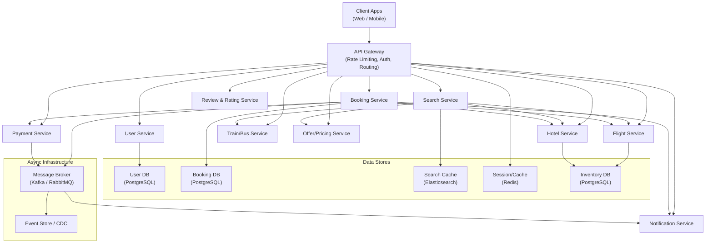
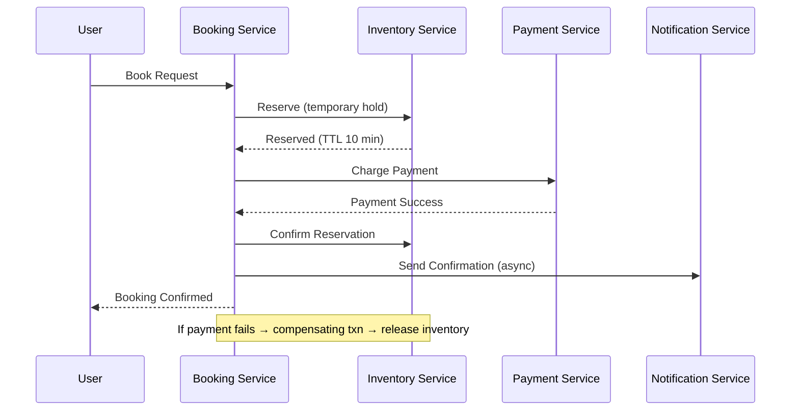
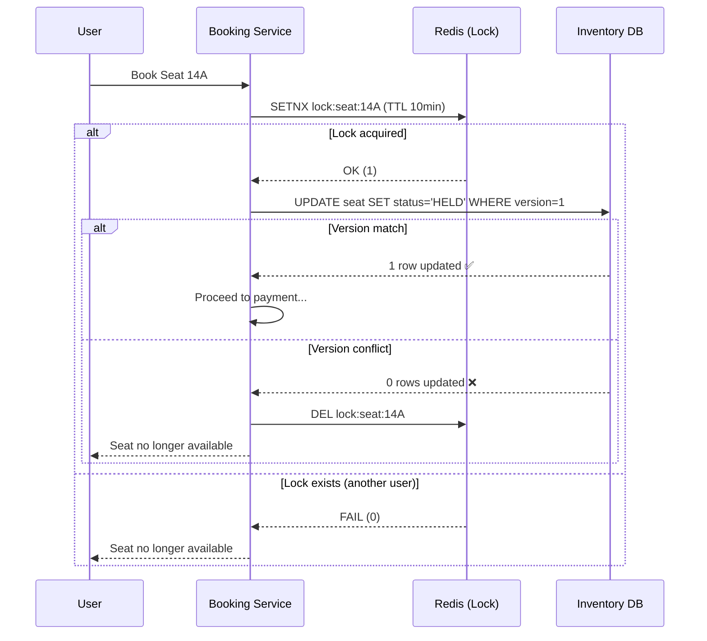
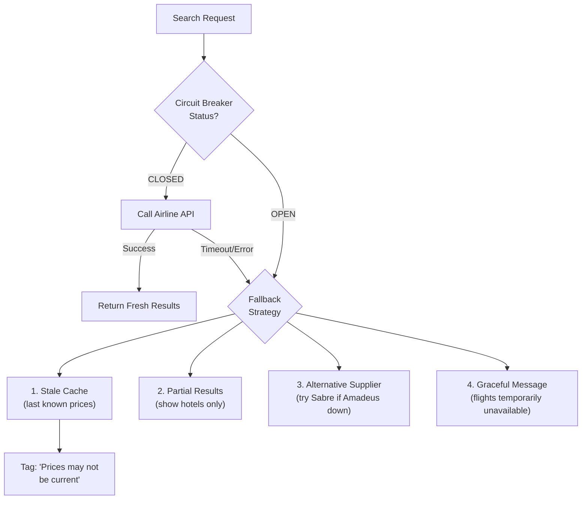
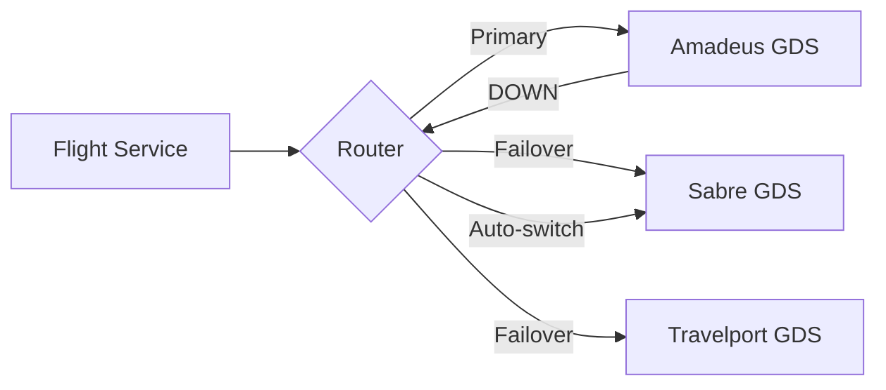
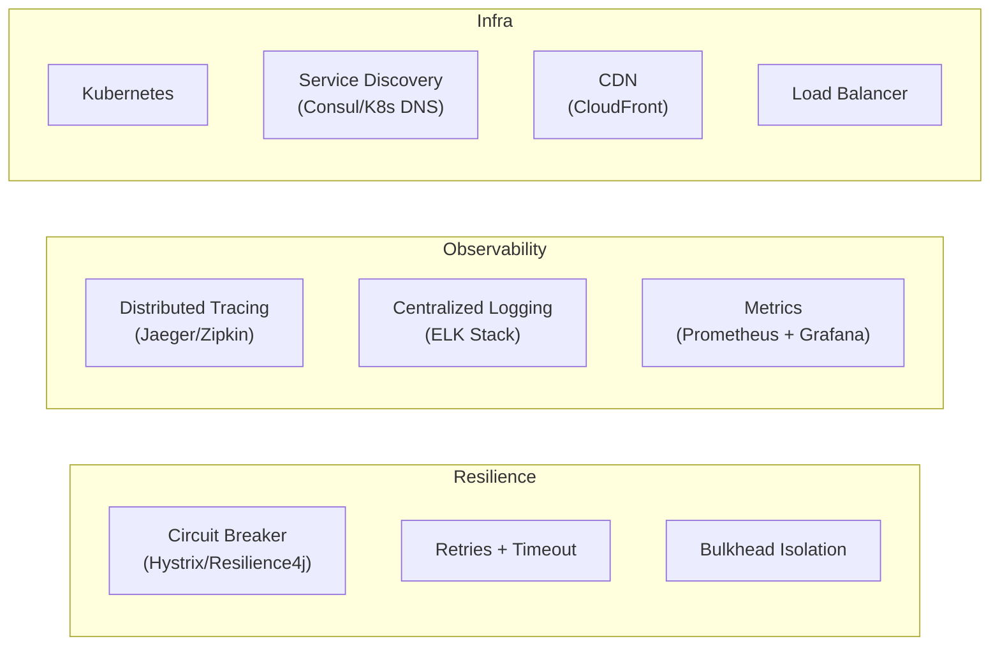

# High-Level Microservice Architecture for a Travel Booking Platform (MakeMyTrip-like)

## Table of Contents

- [Core Microservices](#core-microservices)
- [Key Services Breakdown](#key-services-breakdown)
- [Critical Design Decisions](#critical-design-decisions)
  - [1. Search — The Hardest Part](#1-search--the-hardest-part)
  - [2. Booking — Saga Pattern (not 2PC)](#2-booking--saga-pattern-not-2pc)
    - [2.1 Saga Pattern Deep-Dive](#21-saga-pattern-deep-dive)
    - [2.2 Preventing Inventory Double-Booking](#22-preventing-inventory-double-booking)
    - [2.3 Handling Supplier (Airline API) Downtime](#23-handling-supplier-airline-api-downtime)
  - [3. Database Per Service](#3-database-per-service)
  - [4. API Gateway](#4-api-gateway)
- [Non-Functional Architecture](#non-functional-architecture)
- [Interview Tips for This Question](#interview-tips-for-this-question)
- [Appendices](#appendices)
  - [Elasticsearch — What It Is and How It's Used](#elasticsearch--what-it-is-and-how-its-used)
  - [Glossary](#glossary)

## Core Microservices



## Key Services Breakdown

| Service | Responsibility | DB | Communication |
|---|---|---|---|
| **User Service** | Auth, profile, preferences, loyalty | PostgreSQL | Sync (REST/gRPC) |
| **Search Service** | Aggregates results from flight/hotel/bus, applies filters, ranking | Elasticsearch + Redis | Sync fanout to inventory services |
| **Flight/Hotel/Bus Service** | Inventory, availability, GDS/supplier integration | PostgreSQL + cache | Sync (gRPC to suppliers) |
| **Booking Service** | Orchestrates booking flow, holds temporary inventory | PostgreSQL (ACID) | Saga pattern (async events) |
| **Payment Service** | Payment gateway integration, refunds, wallets | PostgreSQL (isolated) | Async events for confirmation |
| **Offer/Pricing Service** | Dynamic pricing, coupons, discounts | Redis + rules engine | Sync |
| **Notification Service** | Email, SMS, push, WhatsApp | Queue consumer | Async (event-driven) |
| **Review Service** | Ratings, reviews, moderation | MongoDB | Async |

## Critical Design Decisions

### 1. Search — The Hardest Part

- **Fanout pattern**: Search service fans out to Flight, Hotel, Bus services in parallel
- **Cache aggressively**: search results are cached in Redis/Elasticsearch (TTL 5–15 min)
- **Eventual consistency** is acceptable — prices may change between search and booking

### 2. Booking — Saga Pattern (not 2PC)



- Use **choreography-based saga** for simple flows, **orchestration-based saga** for complex multi-leg trips
- Temporary inventory holds with TTL prevent double-booking without distributed locks

#### 2.1 Saga Pattern Deep-Dive

##### The Problem

In a monolith, you have one database. If something fails mid-operation, you just `ROLLBACK` the whole transaction. Easy.

In microservices, each service has its **own database**. There's no single `ROLLBACK` button across multiple services. So how do you handle a multi-step operation where step 3 fails but steps 1 and 2 already committed?

**That's what the Saga pattern solves.**

##### The Idea

A Saga breaks a big transaction into a **chain of small, local transactions**. Each service does its part and triggers the next. If any step fails, it runs **compensating transactions** (undo actions) for the steps that already succeeded.

> Think of it like booking a vacation manually: you book the flight, then the hotel, then the cab. If the hotel says "no rooms available," you cancel the flight you already booked.

##### Real Example: MakeMyTrip Booking

**Happy path (everything works):**

```
Step 1: Booking Service    → Create booking record (status: PENDING)
Step 2: Inventory Service  → Reserve the flight seat (temporary hold)
Step 3: Payment Service    → Charge ₹15,000 from user's card
Step 4: Inventory Service  → Confirm the seat (permanent)
Step 5: Notification Service → Send confirmation email + SMS
Step 6: Booking Service    → Update booking (status: CONFIRMED)
```

**Failure at Step 3 (payment fails):**

```
Step 1: Booking Service    → ✅ Created booking (PENDING)
Step 2: Inventory Service  → ✅ Reserved seat
Step 3: Payment Service    → ❌ Card declined!

Now run compensating transactions (undo in reverse):
Undo 2: Inventory Service  → Release the reserved seat
Undo 1: Booking Service    → Update booking (status: FAILED)
```

No seat is stuck in "reserved" limbo. No ghost booking exists. The system is consistent again.

##### Two Flavors

| Type | How it works | Best for |
|---|---|---|
| **Choreography** | Each service listens for events and reacts on its own. No boss. | Simple flows (2–3 steps) |
| **Orchestration** | A central **Orchestrator** service tells each service what to do and when. | Complex flows (4+ steps, branching logic) |

**Choreography example (event-driven):**

```
Booking Service  --"BookingCreated"--> Inventory Service
Inventory Service --"SeatReserved"---> Payment Service
Payment Service  --"PaymentDone"----> Inventory Service
Payment Service  --"PaymentFailed"--> Inventory Service (release seat)
```

Each service just reacts to events. Simple, but hard to trace when things go wrong.

**Orchestration example (centrally managed):**

```
Booking Orchestrator:
  1. Call Inventory → "Reserve seat"
  2. If success → Call Payment → "Charge user"
  3. If success → Call Inventory → "Confirm seat"
  4. If step 2 fails → Call Inventory → "Release seat"
```

One service controls the flow. Easier to debug and manage.

##### Why Not Just Use 2PC (Two-Phase Commit)?

| | Saga | 2PC |
|---|---|---|
| **Coupling** | Loose — services are independent | Tight — all services must coordinate and lock |
| **Performance** | Fast — no global locks | Slow — holds locks across all services |
| **Scalability** | Scales well | Doesn't scale in distributed systems |
| **Complexity** | You write compensating logic | The protocol handles rollback, but blocks everything |

**Rule of thumb:** In microservices, use Sagas. 2PC is for monolithic databases.

##### Key Takeaway

> **Saga = a chain of local transactions + undo actions for each step.** If any step fails, run the undo actions in reverse. No global locks, no tight coupling, but you must design the compensating transactions carefully.

#### 2.2 Preventing Inventory Double-Booking

This is one of the hardest problems in travel booking systems. Here are the key strategies:

##### 1. Pessimistic Locking with Temporary Holds (Most Common)

```
User A searches → sees Seat 14A available
User B searches → sees Seat 14A available (same time)
User A clicks "Book" → system places a TEMPORARY HOLD (TTL = 10 min)
User B clicks "Book" → system says "Seat 14A no longer available" ❌
```

**How it works:**
- When a user initiates booking, the Inventory Service places a **temporary lock** (hold) on the resource with a TTL
- The hold is stored in **Redis** (atomic operations via `SETNX` / `SET ... NX`)
- If payment succeeds within TTL → hold converts to a confirmed reservation
- If payment fails or TTL expires → hold is automatically released

```
Redis key:  lock:flight:AI-302:seat:14A
Value:      booking-id-12345
TTL:        600 seconds (10 min)

SETNX → returns 1 (lock acquired) → proceed to payment
SETNX → returns 0 (already locked) → reject with "seat unavailable"
```

##### 2. Optimistic Concurrency Control (for high-throughput)

Use a **version column** in the database:

```sql
-- User A reads seat (version = 1)
SELECT version FROM seats WHERE flight_id = 'AI-302' AND seat = '14A';

-- User A tries to book
UPDATE seats 
SET status = 'BOOKED', booked_by = 'user-A', version = version + 1
WHERE flight_id = 'AI-302' AND seat = '14A' AND version = 1;
-- Returns: 1 row affected ✅ (success)

-- User B tries to book (still has version = 1)
UPDATE seats 
SET status = 'BOOKED', booked_by = 'user-B', version = version + 1
WHERE flight_id = 'AI-302' AND seat = '14A' AND version = 1;
-- Returns: 0 rows affected ❌ (version already changed — conflict!)
```

No locks held. The second writer simply fails and retries or gets an error.

##### 3. Idempotency Keys (Prevent Duplicate Charges)

```
POST /api/bookings
Header: Idempotency-Key: txn-abc-123

First call  → processes booking → returns 201
Second call → detects same key → returns cached 201 (no duplicate)
```

Stored in Redis or a DB table:

```
idempotency_keys:
  key: "txn-abc-123"
  response: { booking_id: 456, status: "CONFIRMED" }
  ttl: 24 hours
```

##### 4. Database-Level Uniqueness (Last Line of Defense)

```sql
CREATE UNIQUE INDEX idx_one_booking_per_seat 
ON bookings (flight_id, seat_number) 
WHERE status IN ('HELD', 'CONFIRMED');
```

Even if all application-level checks fail, the database **will reject** the duplicate insert.

##### 5. The Complete Strategy (Layered Defense)

```
Layer 1: Redis distributed lock (SETNX)     → fast, prevents most conflicts
Layer 2: Optimistic versioning in DB         → catches race conditions
Layer 3: Unique constraint in DB             → absolute last safety net
Layer 4: Idempotency key                     → prevents duplicate submissions
Layer 5: TTL-based auto-release              → prevents stuck inventory
```



##### Key Interview Points

| Question | Answer |
|---|---|
| **Why Redis lock + DB version?** | Redis is fast (sub-ms) but volatile. DB is durable but slower. Layer both. |
| **Why TTL on holds?** | Users abandon carts. Without TTL, inventory gets stuck forever. |
| **What about hotel rooms vs flight seats?** | Seats are unique (14A). Hotel rooms are fungible (any "Deluxe King"). Use a **counter** (`available_count`) with atomic decrement for hotels instead of per-item locks. |
| **What if Redis goes down?** | Fall back to DB-level optimistic locking. Slower but still correct. |
| **Distributed lock across multiple Redis nodes?** | Use **Redlock algorithm** (lock across N/2+1 Redis nodes for consensus). |

#### 2.3 Handling Supplier (Airline API) Downtime

When an external supplier like an airline GDS (Amadeus, Sabre) or a hotel API goes down, your system must **degrade gracefully** — not crash. Here's the multi-layered strategy:

##### 1. Circuit Breaker Pattern (First Line of Defense)

```
Normal state:     Requests flow to Airline API normally
                        ↓
Failures pile up: 5 failures in 30 seconds → CIRCUIT OPENS
                        ↓
Open state:       All requests fail-fast instantly (no waiting for timeout)
                  Return cached/fallback data instead
                        ↓
Half-open state:  After 60 seconds, let ONE request through to test
                        ↓
If success:       CIRCUIT CLOSES → resume normal traffic
If failure:       Stay OPEN → retry test again after 60 seconds
```

```
Circuit Breaker Config (Resilience4j):
  failure_rate_threshold: 50%        # open if 50% of calls fail
  wait_duration_in_open_state: 60s   # wait before testing again
  sliding_window_size: 10            # evaluate last 10 calls
  timeout: 3s                        # don't wait > 3s per call
```

**Without circuit breaker:** 1000 users searching → 1000 threads stuck waiting for a dead API → your service crashes too (cascading failure).

**With circuit breaker:** After 5 failures → instant fail-fast → your service stays healthy.

##### 2. Fallback Strategies (What to Show Users)



| Strategy | When to Use | Example |
|---|---|---|
| **Stale cache** | Data was recently valid (< 30 min old) | Show last-known flight prices with a “prices may have changed” banner |
| **Partial results** | Only one supplier is down | Search results show hotels + buses but flights section says “temporarily unavailable” |
| **Alternative supplier** | Multiple GDS integrations | If Amadeus is down, route to Sabre or Travelport |
| **Graceful degradation** | No cached data, no alternatives | Show a clear message instead of a 500 error: “Flight search is temporarily unavailable. Try again in a few minutes.” |

##### 3. Bulkhead Isolation (Contain the Blast Radius)

```
Without bulkhead:
  Thread Pool (100 threads shared)
  ├── Flight API calls (stuck) → uses ALL 100 threads
  ├── Hotel API calls → 0 threads left → BLOCKED ❌
  └── Bus API calls → 0 threads left → BLOCKED ❌

With bulkhead:
  Flight Thread Pool (30 threads)  → stuck, but isolated
  Hotel Thread Pool (40 threads)   → working fine ✅
  Bus Thread Pool (30 threads)     → working fine ✅
```

Each supplier gets its **own thread pool / connection pool**. A dead airline API can’t starve your hotel or bus searches.

##### 4. Retry with Exponential Backoff + Jitter

```
Attempt 1: Call API → timeout after 3s
Wait: 1s + random(0-500ms)
Attempt 2: Call API → timeout after 3s
Wait: 2s + random(0-500ms)
Attempt 3: Call API → timeout after 3s
Wait: 4s + random(0-500ms)
Give up → trigger circuit breaker → use fallback
```

**Why jitter?** Without it, when the API comes back, all your servers retry at the exact same moment → **thundering herd** → API crashes again.

##### 5. Multi-Supplier Routing (Active-Active or Active-Passive)



| Mode | How it works |
|---|---|
| **Active-Passive** | Always call Amadeus. If circuit opens, switch to Sabre. |
| **Active-Active** | Call Amadeus AND Sabre in parallel. Return whichever responds first. Costs more but highest availability. |
| **Weighted routing** | 70% Amadeus, 30% Sabre normally. Shift to 0/100 when Amadeus is down. |

##### 6. Booking Flow: What If Supplier Dies Mid-Booking?

This is the scariest scenario — user has paid but the airline API is down for confirmation.

```
User pays ₹15,000 → Payment SUCCESS → Call Airline API to confirm seat → API DOWN ❌

DO NOT immediately refund. Instead:

1. Mark booking as PENDING_CONFIRMATION
2. Queue a retry job (exponential backoff, max 30 min)
3. Notify user: "Booking received, confirming with airline..."
4. Background worker retries every 2 min
5. If confirmed within 30 min → send confirmation
6. If still failing after 30 min → alert ops team for manual intervention
7. Auto-refund only after manual review OR 24-hour timeout
```

##### 7. Observability (Know Before Users Complain)

```
Alert rules:
  - Airline API error rate > 10% for 2 min     → P2 alert to on-call
  - Airline API error rate > 50% for 1 min     → P1 alert + auto-failover
  - Circuit breaker OPEN for any supplier       → Slack notification
  - Fallback cache hit rate > 80%               → Stale data warning
  - Pending confirmations queue > 50            → Ops team alert
```

##### Key Interview Summary

> **“When a supplier goes down, we don’t go down with it.”**
>
> Circuit breakers fail-fast, bulkheads isolate the damage, cached data keeps search working, multi-supplier routing provides redundancy, and async retry queues handle mid-booking failures. The user sees degraded results — not errors.

### 3. Database Per Service

- Each microservice owns its data — no shared databases
- Use **event-driven communication** (Kafka) for cross-service data needs
- CQRS for search: writes go to primary DB, reads served from Elasticsearch

### 4. API Gateway

- Single entry point: routing, rate limiting, auth token validation
- Use **BFF (Backend-for-Frontend)** pattern — separate gateways for web vs mobile

## Non-Functional Architecture



| Concern | Solution |
|---|---|
| **Resilience** | Circuit breakers on all external calls (GDS, payment gateways), bulkhead isolation per service |
| **Scaling** | Search and Booking scale independently; Search needs 10x more instances than Booking |
| **Caching** | Multi-layer: CDN → API Gateway cache → Redis → Elasticsearch |
| **Consistency** | Eventual consistency everywhere except Payment (strong consistency) |
| **Idempotency** | Every booking/payment API is idempotent (idempotency key in header) |
| **Rate Limiting** | Per-user and per-IP at the gateway level |

## Interview Tips for This Question

1. **Start top-down**: client → gateway → services → data stores → async infra
2. **Call out trade-offs**: why saga over 2PC, why eventual consistency for search, why strong consistency for payments
3. **Discuss the hardest problems**: inventory double-booking, search result staleness, payment failure handling
4. **Mention scale numbers**: "Search gets 100x the traffic of Booking" — shows you think about real load
5. **Don't forget**: observability, failure modes, and how you'd handle a supplier (airline API) going down

This covers the high-level architecture. For the interview, depth on the **booking saga**, **search fanout + caching strategy**, and **failure handling** will differentiate you.

---

## Appendices

### Elasticsearch — What It Is and How It's Used

#### What Is Elasticsearch?

Elasticsearch is a **search engine for your data**. Think of it like Google, but for your own application's data instead of the internet.

You put your data into Elasticsearch, and it **indexes** everything — meaning it organizes the data in a way that makes searching extremely fast. Instead of scanning every record one by one (like a SQL `WHERE` clause), it uses an **inverted index** (like the index at the back of a textbook) to jump straight to matching results.

#### Key Characteristics

- **Full-text search** — finds results even with typos, synonyms, or partial matches ("runnng" still finds "running")
- **Near real-time** — data is searchable within ~1 second of being added
- **Distributed** — spreads data across multiple servers (nodes) automatically, so it scales horizontally
- **Schema-free JSON** — you store documents as JSON; no rigid table structure required

#### How It's Used (General)

| Use Case | Example |
|---|---|
| **Application search** | Product search on e-commerce sites (Amazon-style search bars) |
| **Log & event analysis** | Centralized logging with the ELK stack (Elasticsearch + Logstash + Kibana) to troubleshoot server issues |
| **Metrics & monitoring** | Tracking application performance, CPU usage, error rates |
| **Security analytics** | Detecting suspicious login patterns or intrusion attempts |
| **Autocomplete** | "Did you mean…" suggestions as you type |
| **Geospatial search** | "Find restaurants within 5 km of me" |

#### How It's Used in This Architecture

In this MakeMyTrip-like system, Elasticsearch powers the **Search Service**:

1. **Search cache**: Flight, hotel, and bus results are indexed into Elasticsearch so users get sub-second search responses instead of waiting for real-time supplier API calls
2. **CQRS read store**: Writes go to PostgreSQL (source of truth), and changes are synced to Elasticsearch via CDC/Kafka for optimized reads
3. **Full-text filtering**: Users can search by destination name, hotel description, amenities, etc. — Elasticsearch handles fuzzy matching and relevance ranking
4. **ELK Stack logging**: Combined with Logstash and Kibana, Elasticsearch stores and searches centralized logs from all microservices for debugging and monitoring

#### Quick Analogy

> **SQL database** = a filing cabinet — great for organized storage and precise lookups by ID.
> **Elasticsearch** = a librarian — great at finding things by content, even when you describe them vaguely.

#### When to Use It vs. When Not To

| ✅ Use Elasticsearch when | ❌ Don't use Elasticsearch when |
|---|---|
| You need fast, flexible text search across large volumes | You need it as your primary database (no ACID transactions) |
| You're aggregating logs or metrics from many sources | Simple CRUD apps where a relational DB already works fine |
| Your users expect relevant, ranked results (not just exact matches) | Data integrity (ACID guarantees) is critical |

> **In most real-world architectures, Elasticsearch sits alongside a primary database** — the primary DB is the source of truth, and Elasticsearch is the search layer.

### Glossary

#### Technologies

| Term | Description |
|---|---|
| **PostgreSQL** | Open-source relational database known for ACID compliance, used here for transactional data (users, bookings, inventory). |
| **MongoDB** | NoSQL document database suited for flexible schemas, used here for reviews and ratings. |
| **Redis** | In-memory key-value store used for caching, session management, and real-time data with sub-millisecond latency. |
| **Elasticsearch** | Distributed search and analytics engine, used here to power fast full-text search across flights, hotels, and buses. |
| **Kafka** | Distributed event streaming platform used as a message broker for async, decoupled communication between microservices. |
| **RabbitMQ** | Message broker that supports multiple messaging protocols; an alternative to Kafka for lighter async workloads. |
| **Kubernetes (K8s)** | Container orchestration platform that automates deployment, scaling, and management of containerized microservices. |
| **Hystrix / Resilience4j** | Libraries that implement the circuit breaker pattern to prevent cascading failures across services. Resilience4j is the modern replacement for the now-deprecated Hystrix. |
| **Jaeger / Zipkin** | Distributed tracing systems that track requests as they flow across multiple microservices, helping diagnose latency and failures. |
| **ELK Stack** | Elasticsearch + Logstash + Kibana — a centralized logging pipeline for aggregating, searching, and visualizing logs from all services. |
| **Prometheus** | Open-source monitoring system that scrapes metrics from services and stores them as time-series data. |
| **Grafana** | Visualization and dashboarding tool, commonly paired with Prometheus for real-time service health monitoring. |
| **Consul** | Service discovery and configuration tool that lets microservices find each other dynamically without hardcoded addresses. |
| **CloudFront** | AWS CDN (Content Delivery Network) that caches and serves static assets from edge locations close to users. |
| **REST** | Representational State Transfer — an HTTP-based architectural style for designing stateless APIs. |
| **gRPC** | High-performance RPC framework by Google using Protocol Buffers; preferred for low-latency service-to-service communication. |

#### Architectural Concepts

| Term | Description |
|---|---|
| **Microservices** | An architecture style where the application is composed of small, independently deployable services, each owning its own data and business logic. |
| **API Gateway** | A single entry point that routes client requests to the appropriate microservice, handling cross-cutting concerns like auth, rate limiting, and logging. |
| **BFF (Backend-for-Frontend)** | A pattern where separate API gateway layers are built for different clients (web, mobile) to tailor responses to each platform's needs. |
| **Saga Pattern** | A distributed transaction pattern where each service executes its local transaction and publishes events; failures trigger compensating transactions to roll back. |
| **Choreography-based Saga** | Services listen to events and react independently — no central coordinator. Simpler but harder to debug in complex flows. |
| **Orchestration-based Saga** | A central orchestrator service directs the saga steps — easier to manage for complex multi-step transactions. |
| **2PC (Two-Phase Commit)** | A distributed transaction protocol that locks resources across services. Avoided in microservices due to tight coupling and poor scalability. |
| **CQRS (Command Query Responsibility Segregation)** | A pattern that separates read and write models — writes go to a primary DB, reads are served from an optimized read store (e.g., Elasticsearch). |
| **CDC (Change Data Capture)** | A technique that captures row-level changes in a database and streams them as events, enabling real-time data synchronization between services. |
| **Event-Driven Architecture** | Services communicate by producing and consuming events asynchronously, enabling loose coupling and better scalability. |
| **Fanout Pattern** | A single request is broadcast to multiple downstream services in parallel, and results are aggregated — used here in the Search service. |
| **Eventual Consistency** | A consistency model where data across services will become consistent over time, but may be temporarily stale. Acceptable for search results, not for payments. |
| **Strong Consistency** | Every read returns the most recent write. Required for critical operations like payments and inventory confirmation. |
| **ACID** | Atomicity, Consistency, Isolation, Durability — properties of reliable database transactions. |
| **Circuit Breaker** | A resilience pattern that stops calling a failing downstream service after repeated failures, allowing it time to recover before retrying. |
| **Bulkhead Isolation** | A resilience pattern that isolates failures to one part of the system (like watertight compartments in a ship), preventing a failing service from consuming all resources. |
| **Idempotency** | Designing APIs so that making the same request multiple times produces the same result — critical for payment and booking APIs to handle retries safely. |
| **TTL (Time-to-Live)** | An expiration time set on cached data or temporary resource holds, after which they are automatically invalidated or released. |
| **Rate Limiting** | Controlling the number of requests a client can make within a time window to protect services from abuse or overload. |
| **Service Discovery** | A mechanism that allows microservices to dynamically find and communicate with each other without hardcoded endpoints. |
| **Distributed Tracing** | Tracking a single request as it traverses multiple microservices, assigning a unique trace ID to correlate logs and latency across the system. |
| **CDN (Content Delivery Network)** | A geographically distributed network of servers that caches and delivers content from the nearest edge location to reduce latency. |
| **Load Balancer** | Distributes incoming traffic across multiple instances of a service to ensure availability and even resource utilization. |
| **GDS (Global Distribution System)** | A network (e.g., Amadeus, Sabre) that connects travel service providers (airlines, hotels) with travel agencies and booking platforms for real-time inventory and pricing. |
| **Compensating Transaction** | A transaction that undoes the effect of a previously committed transaction in a saga, used to maintain consistency when a later step fails. |
| **Pessimistic Locking** | A concurrency strategy that locks a resource before modifying it, preventing other transactions from accessing it until the lock is released. |
| **Optimistic Concurrency Control** | A strategy that allows multiple transactions to proceed without locking, detecting conflicts at write time using a version number or timestamp. |
| **SETNX (SET if Not eXists)** | A Redis atomic operation that sets a key only if it doesn't already exist — used to implement distributed locks. |
| **Redlock Algorithm** | A distributed locking algorithm for Redis that acquires locks across a majority (N/2+1) of independent Redis nodes to ensure correctness even if some nodes fail. |
| **Partial Index (Filtered Index)** | A database index that only includes rows matching a `WHERE` condition — used here to enforce uniqueness only on active bookings (HELD/CONFIRMED). |
| **Exponential Backoff** | A retry strategy where the wait time between retries doubles each attempt (1s, 2s, 4s, 8s...), reducing load on a struggling service. |
| **Jitter** | Random variation added to retry delays to prevent a thundering herd — where all clients retry at the same instant and overwhelm the recovering service. |
| **Thundering Herd** | A failure pattern where many clients simultaneously retry or reconnect to a recovering service, causing it to crash again under the sudden load spike. |
| **Graceful Degradation** | A design strategy where the system continues to function with reduced capability when a component fails, rather than failing completely. |
| **Cascading Failure** | A chain reaction where one service’s failure causes dependent services to fail, which causes their dependents to fail, eventually bringing down the whole system. |
| **Active-Active Failover** | A redundancy strategy where multiple suppliers/instances are called simultaneously; the fastest response wins. Higher cost but maximum availability. |
| **Active-Passive Failover** | A redundancy strategy where a backup supplier is only activated when the primary fails. Lower cost but slightly slower failover. |
