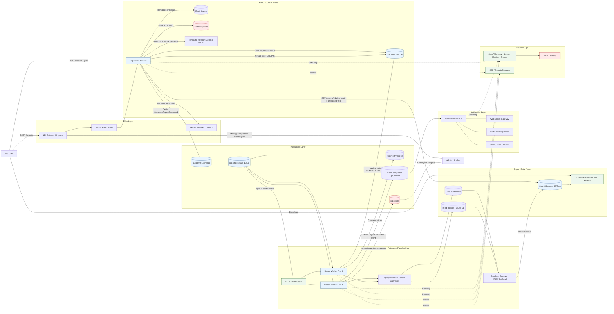
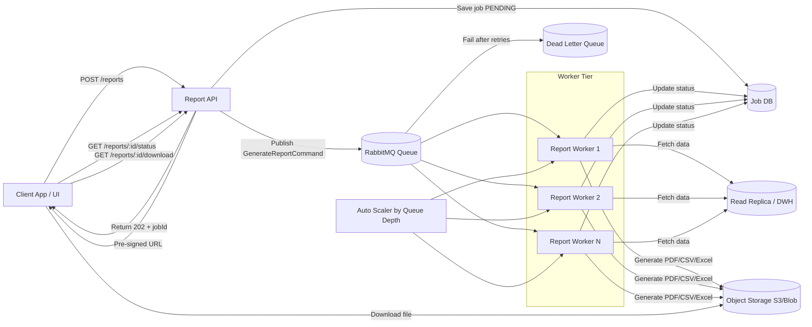

# Microservice Architecture for Report Generation

## Table of Contents

1. [Problem Statement](#problem-statement)
2. [Architectural Overview](#architectural-overview)
3. [Core Architectural Components](#core-architectural-components)
   - [1. API & Job Queueing Layer](#1-api--job-queueing-layer)
   - [2. Scalable Data Ingestion](#2-scalable-data-ingestion)
   - [3. Output Storage & Delivery](#3-output-storage--delivery)
4. [Extensibility & Strategy Pattern](#extensibility--strategy-pattern)
5. [Non-Functional Considerations](#non-functional-considerations)
6. [Session Summary](#session-summary)
7. [POST /reports — Request Payload](#post-reports--request-payload)
   - [C# DTO](#c-dto)
   - [JSON Payload Example](#json-payload-example)
   - [202 Accepted Response](#202-accepted-response)
8. [Preconfigured vs. Dynamic Reports](#preconfigured-vs-dynamic-reports)
9. [Extending for Dynamic Reports](#extending-for-dynamic-reports)
   - [Dynamic Request Payload](#dynamic-request-payload)
   - [New Architectural Layers Required](#new-architectural-layers-required)
   - [Query Builder](#query-builder)
   - [Security Risks to Guard Against](#security-risks-to-guard-against)
   - [When to Use Each Approach](#when-to-use-each-approach)
10. [Report Worker Nodes — Explained Simply](#report-worker-nodes--explained-simply)
    - [1. They Live in the Background (Non-blocking)](#1-they-live-in-the-background-non-blocking)
    - [2. They are Stateless (Easily Replaceable)](#2-they-are-stateless-easily-replaceable)
    - [3. They Scale Up and Down Automatically](#3-they-scale-up-and-down-automatically)
11. [Worker Nodes — Old School vs. Modern Concepts](#worker-nodes--old-school-vs-modern-concepts)
    - [What IS a Worker Node in Code?](#what-is-a-worker-node-in-code)
    - [Does Each Report Run in Its Own Process?](#does-each-report-run-in-its-own-process)
    - [The Process Level (Inside the Worker)](#a-the-process-level-inside-the-worker)
    - [The Container Level (Deployment & Scaling)](#b-the-container-level-deployment--scaling)
    - [Old School vs. Modern Mapping](#old-school-vs-modern-mapping)
12. [Job Assignment & Worker Scaling](#job-assignment--worker-scaling)
    - [Job Assignment — The Queue Does This Automatically](#job-assignment--the-queue-does-this-automatically)
    - [Spawning New Worker Nodes — The Hosting Platform Decides](#spawning-new-worker-nodes--the-hosting-platform-decides)
    - [The Full Picture](#the-full-picture)
    - [Clarification — The Loop vs. How Many Workers](#clarification--the-loop-vs-how-many-workers)
    - [How Many Workers Are Running the Loop?](#how-many-workers-are-running-the-loop)
    - [Practical Worker Count Numbers](#practical-worker-count-numbers)
13. [Building a Worker Node — Implementation Guide](#building-a-worker-node--implementation-guide)
    - [Architectural Design Pattern](#architectural-design-pattern)
    - [Step 1: Define Contracts & Strategy Interface](#step-1-define-contracts--strategy-interface)
    - [Step 2: Implement Specific Report Strategies](#step-2-implement-specific-report-strategies)
    - [Step 3: Worker Consumer (Queue Processor)](#step-3-worker-consumer-queue-processor)
    - [Step 4: Host Registration & Resilience Setup](#step-4-host-registration--resilience-setup)
    - [Best Practices for Production Deployment](#best-practices-for-production-deployment)
14. [MassTransit in This Architecture](#masstransit-in-this-architecture)
  - [What MassTransit Is](#what-masstransit-is)
  - [Minimal Producer / Consumer Example](#minimal-producer--consumer-example)
  - [MassTransit vs. Plain RabbitMQ](#masstransit-vs-plain-rabbitmq)
  - [Where It Fits in the Microservice Architecture](#where-it-fits-in-the-microservice-architecture)
15. [Architecture Diagrams](#architecture-diagrams)
  - [Full Production Diagram](#full-production-diagram)
  - [Simplified Interview Diagram](#simplified-interview-diagram)

---

## Problem Statement
Design a microservice architecture capable of generating different types of reports (PDF, CSV, Excel, custom formats) for users efficiently, reliably, and at scale without affecting main system performance.

---

## Architectural Overview

Report generation is an **asynchronous, I/O- and CPU-heavy background operation**. The system decouples request handling from report execution using an event-driven microservice pattern.

```
 Client (UI/API Gateway)
        │
        ├── 1. POST /reports ──────────► [ Report Service (API) ]
        │                                         │
        │                                2. Save job (Status: PENDING)
        │                                         │
        │                                3. Publish Message
        │                                         ▼
        │                                  [ Message Queue ]
        │                                         │
        │                                4. Consume Message
        │                                         ▼
        │                                [ Report Worker Nodes ]
        │                                    ├── Fetch Data (Read Replica)
        │                                    ├── Generate (PDF/CSV/Excel)
        │                                    └── Upload File
        │                                         │
        │                                5. Save S3 URL
        │                                         ▼
        ◄── 6. GET /reports/{id}/download ─── [ Object Storage (S3) ]
```

---

## Core Architectural Components

### 1. API & Job Queueing Layer
* **Decoupled API:** Receives `POST /reports`, records metadata with status `PENDING`, pushes a task to a message queue (e.g., RabbitMQ, AWS SQS, or Kafka), and returns `202 Accepted` immediately with a `jobId`.
* **Worker Pool:** Dedicated stateless worker nodes consume jobs from the queue, ensuring heavy workloads don't starve user-facing API endpoints.

### 2. Scalable Data Ingestion
* **Read Replicas / Data Warehouse:** Workers source data from read replicas or dedicated analytics stores (e.g., Snowflake, BigQuery)—never primary transactional databases (OLTP).
* **Streaming Data:** For large datasets, use cursor-based database streaming and output file streaming to keep memory footprint bounded.

### 3. Output Storage & Delivery
* **Blob Storage:** Output files (PDF, CSV, Excel) are persisted to Object Storage (e.g., AWS S3, Azure Blob Storage).
* **Pre-signed URLs:** Downloads use short-lived pre-signed URLs directly from storage, avoiding proxying bytes back through API servers.

---

## Extensibility & Strategy Pattern

Support for diverse report types is achieved using the **Strategy Pattern**:

```csharp
public interface IReportGenerator
{
    ReportType Type { get; }
    Task<byte[]> GenerateAsync(ReportRequest request, CancellationToken cancellationToken);
}
```

---

## Non-Functional Considerations

* **Delivery Notifications:** WebSockets/Push notifications or polling (`GET /reports/{id}/status`).
* **Resiliency:** Dead Letter Queues (DLQ) for failed retries, exponential backoff, and execution timeouts.
* **Caching:** Hashing query parameters to cache static/periodic report URLs in Redis.
* **Multi-tenancy:** Per-tenant rate limiting to prevent queue starvation.

---

## Session Summary

During the discussion, we clarified the difference between Hangfire and a queue-based worker architecture:

* **Hangfire** also runs jobs in the background, but it is usually part of the same .NET application or a closely coupled Hangfire server setup.
* A **worker service** also runs in the background, but it is typically a separate process, container, or deployable service.
* In a true microservice design, the API should hand off report generation to a separate worker process through a queue or message broker so the API stays fast and the heavy report work is isolated.
* If the worker runs inside the same app/process, that is simpler, but it is closer to a monolith with background jobs than a fully separated microservice.

The practical takeaway is that Hangfire is a good fit for simpler .NET-only setups, while a separate worker service is the better fit when report generation needs stronger isolation, independent scaling, and clearer service boundaries.

---

## POST /reports — Request Payload

The `POST /reports` endpoint accepts a `ReportRequest` payload containing:

- **Report type** — e.g., `PDF`, `CSV`, `Excel`, or custom format
- **Query parameters / filters** — data range, tenant ID, entity filters, etc. (these are also hashed for caching)
- **User/tenant context** — for multi-tenancy and rate limiting
- **Output format options** — e.g., template, locale, column selection

### C# DTO

```csharp
public class ReportRequest
{
    public string ReportName { get; set; }
    public ReportType Format { get; set; }          // PDF, CSV, Excel
    public string TenantId { get; set; }
    public string RequestedBy { get; set; }         // UserId
    public DateTimeOffset From { get; set; }
    public DateTimeOffset To { get; set; }
    public Dictionary<string, string> Filters { get; set; }  // e.g. region, status
    public ReportTemplate? Template { get; set; }   // optional layout/branding
    public string? CallbackUrl { get; set; }        // optional webhook on completion
}

public enum ReportType { PDF, CSV, Excel }
public enum ReportTemplate { Default, Branded, Minimal }
```

### JSON Payload Example

```json
{
  "reportName": "Monthly Sales Summary",
  "format": "PDF",
  "tenantId": "tenant-abc-123",
  "requestedBy": "user-456",
  "from": "2026-07-01T00:00:00Z",
  "to": "2026-07-31T23:59:59Z",
  "filters": {
    "region": "APAC",
    "status": "completed"
  },
  "template": "Branded",
  "callbackUrl": "https://your-app.com/webhooks/report-ready"
}
```

### 202 Accepted Response

```json
{
  "jobId": "rpt-7f3a9c12-4b2e-4d1a-bc88-0f1e2d3a4b5c",
  "status": "PENDING",
  "statusUrl": "/reports/rpt-7f3a9c12-4b2e-4d1a-bc88-0f1e2d3a4b5c/status"
}
```

The `callbackUrl` is optional — if omitted, the client polls `GET /reports/{jobId}/status` until status becomes `COMPLETED`, then calls `GET /reports/{jobId}/download` for the pre-signed S3 URL.

---

## Preconfigured vs. Dynamic Reports

The base architecture uses a **preconfigured report** model — the Strategy Pattern implies the system has a known set of report types coded ahead of time. Each report type has its own concrete implementation registered in the system. The client picks which preconfigured report to run and supplies parameters/filters to shape the data, but the report structure, data sources, and layout are defined by developers.

| | Preconfigured | Dynamic / Ad-hoc |
|---|---|---|
| **Report structure** | Coded by developers | Client defines columns, grouping, sorting |
| **Data source** | Fixed per report type | Client specifies table/entity |
| **Flexibility** | Low | High |
| **Complexity** | Low | High (query builder, security risks) |
| **Example tools** | Custom workers | SSRS, Jasper, Metabase, PowerBI Embedded |

---

## Extending for Dynamic Reports

### Dynamic Request Payload

Instead of picking a named report type, the client sends a **report schema** describing what they want:

```json
{
  "tenantId": "tenant-abc-123",
  "requestedBy": "user-456",
  "format": "Excel",
  "dataSource": "orders",
  "columns": [
    { "field": "orderId", "label": "Order ID" },
    { "field": "customerName", "label": "Customer" },
    { "field": "totalAmount", "label": "Total", "aggregate": "sum" }
  ],
  "filters": {
    "status": "completed",
    "region": "APAC"
  },
  "groupBy": ["region"],
  "sortBy": [{ "field": "totalAmount", "direction": "desc" }],
  "dateRange": { "from": "2026-07-01", "to": "2026-07-31" }
}
```

### New Architectural Layers Required

```
Client
  │
  ▼
[ Report API ]
  ├── 1. Schema Validation (allowed dataSources, columns, filters)
  ├── 2. Authorization Check (can this tenant/user access this dataSource?)
  ├── 3. Save job + Publish to Queue
  ▼
[ Message Queue ]
  ▼
[ Report Worker ]
  ├── 4. Query Builder  ──► builds safe parameterized SQL from schema
  ├── 5. Data Fetcher   ──► runs query against Read Replica
  ├── 6. Renderer       ──► formats output (Excel/CSV/PDF)
  └── 7. Upload to S3
```

### Query Builder

```csharp
public class DynamicQueryBuilder
{
    public (string sql, object[] parameters) Build(ReportSchema schema)
    {
        // Maps whitelisted field names → actual DB column names
        // Builds WHERE, GROUP BY, ORDER BY from validated schema
    }
}
```

- Whitelist allowed `dataSource` values (e.g., `orders`, `inventory`) — never accept raw table names
- Whitelist allowed `columns` per data source — prevents data leakage across tenants
- Always use parameterized queries — never concatenate strings into SQL

### Security Risks to Guard Against

| Risk | Mitigation |
|---|---|
| SQL Injection | Whitelist fields, never interpolate raw input into SQL |
| Data leakage | Always enforce `tenantId` filter server-side |
| Resource exhaustion | Row limits, timeouts, queue depth caps |
| Unauthorised columns | Column whitelist per role/tenant |
| Schema tampering | Validate and sanitize full schema before queuing |

### When to Use Each Approach

| Scenario | Recommendation |
|---|---|
| Fixed, well-known reports | Preconfigured (Strategy Pattern) — simpler, faster |
| User-defined exports/analytics | Dynamic with schema validation |
| Mixed (most real systems) | Both — preconfigured for standard reports, dynamic for custom exports |

The safest real-world pattern is a **hybrid**: preconfigured reports for common use cases, with a constrained dynamic builder for custom exports — never exposing raw query access to clients.

---

## Report Worker Nodes — Explained Simply

Think of **Report Worker Nodes** as a team of background helpers working in a factory.

When a user requests a report, the main web server (the front desk) doesn't stop everything to create it. Instead, it writes down an order, drops it into an in-box (the **Message Queue**), and hands the user a receipt with a tracking number.

The **Report Worker Nodes** are the workers in the back room whose only job is to pick up those orders and process them one by one.

Here is what makes them special:

### 1. They Live in the Background (Non-blocking)

Because creating a PDF or Excel sheet takes time and heavy computer memory, these workers run entirely in the background. This keeps your main website fast and responsive for everyone else, because the front desk never gets frozen waiting for a heavy report to finish.

### 2. They are Stateless (Easily Replaceable)

A worker node doesn't remember past jobs or hold onto personal data permanently. It simply:

1. Picks up a task message.
2. Fetches the required raw data.
3. Builds the file (PDF, CSV, Excel).
4. Uploads the finished file to cloud storage (like AWS S3).
5. Forgets about it and grabs the next task.

Because they don't store local state, if a worker crashes mid-job, another worker can instantly pick up the message and try again.

### 3. They Scale Up and Down Automatically

- **On quiet days:** You might only need **1 or 2 workers** sitting around waiting for jobs.
- **At month-end (when everyone wants reports):** The queue fills up with hundreds of orders. The system sees this and automatically spins up **10 or 20 worker nodes** to handle the heavy load, then turns them back off when the queue is empty.

### Summary

In simple terms, a **Report Worker Node** is just a specialized background process whose sole purpose is to take raw data, convert it into a file (like Excel or PDF), save it to cloud storage, and notify the user when it's ready.

---

## Worker Nodes — Old School vs. Modern Concepts

If you know Console Apps and ASP.NET Web Apps, you already know 90% of this — the modern terminology just wraps old-school concepts in new labels.

### What IS a Worker Node in Code?

At its core, a worker node is **just a Console Application running in an infinite loop**.

In .NET you create a **Worker Service project** (`dotnet new worker`). Under the hood it is a Console App executing a `BackgroundService` that continuously does:

> *Check the queue → Pick up a job → Run the C# logic → Repeat.*

There is **no ASP.NET web server (Kestrel/IIS)** running inside it because it doesn't need to listen for HTTP requests. It only communicates with the message queue.

This maps directly to what you already know:

| Old School | Modern Equivalent | What It Actually Is |
|---|---|---|
| Windows Service / Scheduled Console App | Worker Node / Container | A C# Console app running continuously in the background to process queue messages |
| Windows Server / IIS Server | Docker Container / Kubernetes | The isolated environment where your executable runs |
| Database Table acting as a Job Queue | RabbitMQ / AWS SQS / Kafka | A dedicated, high-speed queue system for passing job requests around |
| `System.IO.File.Save()` to local `D:\` drive | AWS S3 / Azure Blob Storage | Uploading the finished file to cloud storage so any web server can serve it via URL |

### Does Each Report Run in Its Own Process?

**Not necessarily per report — but per Worker instance.**

#### A. The Process Level (Inside the Worker)

When a single Worker (Console App) picks up a report task from the queue, it processes it asynchronously on a **thread** via `async/await`.

- A single running Worker process might handle **3 or 4 reports concurrently** using multiple threads.
- You configure `ConcurrentMessageLimit` to cap this so it doesn't try to process 100 reports at once and exhaust the server's RAM.

One Worker handles many reports sequentially (or a small number concurrently) — not one process per report. Think of it like a checkout operator serving many customers one after another, not one operator hired per customer.

#### B. The Container Level (Deployment & Scaling)

A **Container (Docker)** is a lightweight, isolated wrapper around your running Console App and its dependencies (.NET runtime, libraries). Instead of installing .NET and hosting your EXE on a Windows Server, you package the Console App into a Docker image:

```
┌────────────────────────────────────────────────────────┐
│  Docker Container (Virtual Boundary)                   │
│                                                        │
│   ┌────────────────────────────────────────────────┐   │
│   │  Your .NET Console App (Worker.exe)            │   │
│   │                                                │   │
│   │   ├── Thread 1: Processing PDF Report #101     │   │
│   │   ├── Thread 2: Processing CSV Report #102     │   │
│   │   └── Thread 3: Idle / Waiting for Queue       │   │
│   └────────────────────────────────────────────────┘   │
└────────────────────────────────────────────────────────┘
```

The container gives you the ability to run **multiple copies** of that same Console App side by side when load increases, and tear them down when load drops — without touching a server or reinstalling anything.

### Old School vs. Modern Mapping

| Scenario | Old School | Modern Equivalent |
|---|---|---|
| Quiet day, low demand | 1 Windows Service on a server | 1 Worker container |
| Month-end, 500 reports queued | Manually spin up more services or wait | Platform auto-scales to 10–20 containers, then back down |
| Worker crashes mid-job | Message lost or job stuck | Queue re-delivers the message; another container picks it up |
| Deploy a new version | RDP to server, stop service, copy EXE, restart | Push a new Docker image; platform rolls it out with zero downtime |

### Summary

- **Is it a container?** Yes, usually. The C# Console App is packaged inside a Docker container so cloud platforms (Kubernetes, Azure Container Apps) can spin up 5 copies under load and drop to 1 when quiet.
- **Is it an independent process per report?** No — it is one long-running process (Console App) handling a stream of reports across background threads.
- **Do you need containers?** No. You can deploy the same worker as a Windows Service, an Azure WebJob, or a plain console app kept alive by a process manager. Containers are the deployment wrapper, not the logic.

---

## Job Assignment & Worker Scaling

There are **two separate systems** responsible for this, and they operate independently.

### Job Assignment — The Queue Does This Automatically

You don't write any code to assign jobs to workers. The **message queue handles it entirely** using a "competing consumers" pattern:

```
Message Queue
  ├── Job #101 ──► Worker Node A grabs it (first to ask)
  ├── Job #102 ──► Worker Node B grabs it (first to ask)
  ├── Job #103 ──► Worker Node A grabs it (finished #101, now free)
  └── Job #104 ──► waiting... (all workers busy)
```

Each worker node runs a loop that continuously says *"give me the next available message"*. The queue gives each message to **exactly one worker** — whichever asked first. No two workers ever get the same job. This is built into RabbitMQ, SQS, and Azure Service Bus — you get it for free.

There is no dispatcher, no scheduler, no code deciding *"send this job to Worker B"*. Workers compete for messages themselves.

### Spawning New Worker Nodes — The Hosting Platform Decides

This is handled by whichever **platform hosts your containers**, not your application code. The decision is based on a metric you configure — most commonly **queue depth** (how many messages are waiting):

```
Queue depth =  0–10  →  keep 1 worker node running
Queue depth = 11–50  →  scale up to 3 worker nodes
Queue depth = 51+    →  scale up to 10 worker nodes
Queue depth drops    →  scale back down after idle timeout
```

| Platform | How You Configure It |
|---|---|
| **Kubernetes** | KEDA (Kubernetes Event-Driven Autoscaler) — watches queue depth and adds/removes pods |
| **Azure Container Apps** | Built-in scaling rules tied to Azure Service Bus or RabbitMQ queue length |
| **AWS ECS** | CloudWatch alarm on SQS queue depth triggers Auto Scaling |
| **Simple / On-prem** | You don't auto-scale — you manually run N worker processes on a server |

### The Full Picture

```
100 report requests arrive
        │
        ▼
  Queue now has 100 messages
        │
        ▼
  Scaling platform sees queue depth = 100
        │
        ▼
  Spins up 5 worker containers
        │
  Each worker picks up jobs competitively:
  ├── Worker 1: grabs Job #1,  #6,  #11, #16...
  ├── Worker 2: grabs Job #2,  #7,  #12, #17...
  ├── Worker 3: grabs Job #3,  #8,  #13, #18...
  ├── Worker 4: grabs Job #4,  #9,  #14, #19...
  └── Worker 5: grabs Job #5,  #10, #15, #20...
        │
  Queue empties → scaling platform tears down 4 workers
  → back to 1 idle worker
```

**Key takeaways:**
- **Who assigns jobs?** Nobody — workers grab them competitively from the queue
- **Who decides to spawn new workers?** The hosting platform (Kubernetes/Azure/AWS), based on queue depth
- **Your application code does neither** — it just processes whatever message it picks up

### Clarification — The Loop vs. How Many Workers

The confusion comes from mixing up two different levels.

**Level 1 — Inside a single running worker (the loop)**

When a worker process is alive, it runs a continuous internal loop:

```csharp
while (running)
{
    message = queue.WaitForNextMessage();  // blocks until one arrives
    process(message);
}
```

This describes the *behaviour* of one worker — not how many there are.

**Level 2 — How many workers are running that loop (scaling)**

The number of workers running that loop is controlled by the platform based on queue depth. The "loop" description is simply explaining what *one* worker does internally — it says nothing about how many copies of that worker exist at any given time.

Think of it like a factory worker standing at a conveyor belt, picking up items as they come past:
- **The loop** = the worker standing there with their hands ready
- **Scaling** = the factory manager deciding to add or remove workers at the belt depending on how backed up it is

Each worker added runs the **same loop** — they all independently grab the next available item. Nobody coordinates between them. The belt (queue) ensures each item only gets picked up once.

### How Many Workers Are Running the Loop?

At any point in time, it depends entirely on load:

```
Sunday 2am (quiet)
  └── 1 worker running its loop, mostly idle, waiting for messages

Monday 9am (busy)
  └── 1 worker running its loop
  └── 2nd worker running its loop   ← platform spawned it (queue grew)
  └── 3rd worker running its loop   ← platform spawned it (queue grew more)

Monday 11am (back to quiet)
  └── 3rd worker loop stopped       ← platform killed it (queue drained)
  └── 2nd worker loop stopped       ← platform killed it (queue drained)
  └── 1 worker running its loop     ← back to baseline
```

### Practical Worker Count Numbers

You set two independent limits — the **max worker count** (in KEDA/Azure/AWS scaling rules) and the **per-worker concurrency** (via `ConcurrentMessageLimit` in your code):

| Load | Workers Running | Per-Worker Concurrency | Total Simultaneous Jobs |
|---|---|---|---|
| Low | 1 | 1–2 | 1–2 |
| Medium | 2–3 | 2–4 | 4–12 |
| High (month-end) | 5–10 | up to 4 | up to 40 |

The maximum theoretical throughput = **max workers × `ConcurrentMessageLimit`**. Both numbers are yours to configure based on your server's CPU and RAM capacity.

---

## Building a Worker Node — Implementation Guide

In a .NET microservice ecosystem, the most idiomatic way to build these background worker nodes is using **`IHostedService`** or **`BackgroundService`** combined with **MassTransit** (for queue messaging) and **QuestPDF** / **EPPlus** (for generating PDFs and Excel files).

### Architectural Design Pattern

The worker follows a clear, single-responsibility lifecycle:

1. **Consume:** Listens to a queue (e.g., RabbitMQ, Azure Service Bus, SQS) for a `GenerateReportCommand`.
2. **Execute Strategy:** Uses the **Strategy Pattern** to select the correct generator (PDF, CSV, Excel) based on the requested format.
3. **Stream & Process:** Queries the database using streaming/cursor pagination to avoid loading millions of rows into RAM.
4. **Persist:** Uploads the output stream directly to Object Storage (S3 / Azure Blob Storage).
5. **Publish Completion Event:** Sends a `ReportGeneratedEvent` so notification services can alert the user.

### Step 1: Define Contracts & Strategy Interface

```csharp
// The message consumed from the queue
public record GenerateReportCommand(
    Guid JobId,
    string ReportType, // e.g., "PDF", "CSV"
    Dictionary<string, string> Parameters
);

// Event published when work is done
public record ReportGeneratedEvent(
    Guid JobId,
    string DownloadUrl,
    DateTime CompletedAt
);

// Strategy pattern interface for extensible formats
public interface IReportStrategy
{
    string Format { get; } // "PDF", "CSV", "EXCEL"
    Task<Stream> GenerateAsync(Dictionary<string, string> parameters, CancellationToken ct);
}
```

### Step 2: Implement Specific Report Strategies

Here is a simple example streaming CSV data to avoid memory spikes:

```csharp
using System.IO;
using System.Text;

public class CsvReportStrategy : IReportStrategy
{
    public string Format => "CSV";

    public async Task<Stream> GenerateAsync(Dictionary<string, string> parameters, CancellationToken ct)
    {
        var memoryStream = new MemoryStream();
        // Leave stream open so calling code can read and upload it to S3
        var writer = new StreamWriter(memoryStream, Encoding.UTF8, leaveOpen: true);

        // Header
        await writer.WriteLineAsync("Id,Name,Date,Amount");

        // Simulate fetching data in batches/streams from database replica
        for (int i = 1; i <= 1000; i++)
        {
            ct.ThrowIfCancellationRequested();
            await writer.WriteLineAsync($"{i},Transaction_{i},{DateTime.UtcNow:yyyy-MM-dd},100.00");
        }

        await writer.FlushAsync(ct);
        memoryStream.Position = 0; // Reset position for reading/uploading
        return memoryStream;
    }
}
```

### Step 3: Worker Consumer (Queue Processor)

Using **MassTransit**, which abstracts RabbitMQ/Service Bus boilerplate, retry policies, and dead-letter queues out of the box:

```csharp
using MassTransit;

public class GenerateReportConsumer : IConsumer<GenerateReportCommand>
{
    private readonly IEnumerable<IReportStrategy> _strategies;
    private readonly IBlobStorageService _storageService; // S3 or Azure Blob Wrapper
    private readonly ILogger<GenerateReportConsumer> _logger;

    public GenerateReportConsumer(
        IEnumerable<IReportStrategy> strategies,
        IBlobStorageService storageService,
        ILogger<GenerateReportConsumer> logger)
    {
        _strategies = strategies;
        _storageService = storageService;
        _logger = logger;
    }

    public async Task Consume(ConsumeContext<GenerateReportCommand> context)
    {
        var command = context.Message;
        _logger.LogInformation("Processing report job: {JobId}", command.JobId);

        // 1. Resolve the correct generator strategy
        var strategy = _strategies.FirstOrDefault(s =>
            s.Format.Equals(command.ReportType, StringComparison.OrdinalIgnoreCase));

        if (strategy == null)
        {
            throw new InvalidOperationException($"Unsupported report type: {command.ReportType}");
        }

        // 2. Generate file stream
        await using var reportStream = await strategy.GenerateAsync(command.Parameters, context.CancellationToken);

        // 3. Upload directly to Blob Storage (e.g., AWS S3)
        var fileName = $"reports/{command.JobId}.{command.ReportType.ToLower()}";
        var downloadUrl = await _storageService.UploadAsync(fileName, reportStream, context.CancellationToken);

        _logger.LogInformation("Successfully uploaded report {JobId} to {Url}", command.JobId, downloadUrl);

        // 4. Publish completed event for downstream notification service
        await context.Publish(new ReportGeneratedEvent(
            command.JobId,
            downloadUrl,
            DateTime.UtcNow
        ));
    }
}
```

### Step 4: Host Registration & Resilience Setup

In `Program.cs`, set up the worker as an autonomous console daemon with retries and concurrency limits:

```csharp
using MassTransit;

var builder = Host.CreateApplicationBuilder(args);

// Register Strategies
builder.Services.AddTransient<IReportStrategy, CsvReportStrategy>();
// builder.Services.AddTransient<IReportStrategy, PdfReportStrategy>();

// Register Storage Service
builder.Services.AddSingleton<IBlobStorageService, S3StorageService>();

// Configure Queue Consumer & Resilience Policy
builder.Services.AddMassTransit(x =>
{
    x.AddConsumer<GenerateReportConsumer>();

    x.UsingRabbitMq((context, cfg) =>
    {
        cfg.Host("localhost", "/", h => {
            h.Username("guest");
            h.Password("guest");
        });

        cfg.ReceiveEndpoint("report-generation-queue", e =>
        {
            // Limit concurrent processing to prevent CPU/RAM exhaustion
            e.ConcurrentMessageLimit = 4;

            // Retry logic with exponential backoff before sending to Dead Letter Queue (DLQ)
            e.UseMessageRetry(r => r.Exponential(
                retryCount: 3,
                minInterval: TimeSpan.FromSeconds(2),
                maxInterval: TimeSpan.FromSeconds(30),
                delta: TimeSpan.FromSeconds(2)
            ));

            e.ConfigureConsumer<GenerateReportConsumer>(context);
        });
    });
});

var host = builder.Build();
await host.RunAsync();
```

### Best Practices for Production Deployment

1. **Limit Concurrency:** Use `ConcurrentMessageLimit` or container CPU bounds. A single PDF generation task can be CPU intensive; running too many concurrently inside one container will crash it with an Out-Of-Memory (OOM) error.
2. **Stream, Don't Buffer:** Always write and read using `Stream` abstractions directly to S3. Avoid storing giant byte arrays (`byte[]`) in memory.
3. **Graceful Shutdown:** Respect the `CancellationToken`. If Kubernetes terminates a pod to scale down, cancellation tokens allow running jobs to cleanly exit or re-queue mid-process.

---

## MassTransit in This Architecture

MassTransit is the .NET messaging layer used on top of a broker such as RabbitMQ, Azure Service Bus, or Amazon SQS. In this report system, MassTransit is the glue between the API that creates a report job and the worker that executes it. RabbitMQ is the transport; MassTransit is the abstraction that makes the transport easier to use.

### What MassTransit Is

MassTransit gives you a higher-level API for publishing messages, consuming messages, handling retries, and wiring consumers to a queue. That means you write business-focused code instead of broker-specific plumbing.

### Minimal Producer / Consumer Example

```csharp
using MassTransit;

public record ReportRequested(Guid ReportId, string Format);

public class ReportController : ControllerBase
{
  private readonly IPublishEndpoint _publishEndpoint;

  public ReportController(IPublishEndpoint publishEndpoint)
  {
    _publishEndpoint = publishEndpoint;
  }

  [HttpPost("reports")]
  public async Task<IActionResult> CreateReport()
  {
    var reportId = Guid.NewGuid();

    await _publishEndpoint.Publish(new ReportRequested(reportId, "PDF"));

    return Accepted(new { reportId });
  }
}

public class ReportRequestedConsumer : IConsumer<ReportRequested>
{
  public Task Consume(ConsumeContext<ReportRequested> context)
  {
    var message = context.Message;
    Console.WriteLine($"Generating {message.Format} report {message.ReportId}");
    return Task.CompletedTask;
  }
}
```

### MassTransit vs. Plain RabbitMQ

Use **MassTransit** when you are building .NET services and want a consistent application model for consumers, retries, saga support, and testability. It reduces boilerplate and keeps message handling focused on business logic.

Use **plain RabbitMQ** when you want direct broker control, very low-level tuning, or non-.NET producers and consumers that should talk to the broker without an extra abstraction layer.

In short: RabbitMQ is the broker, MassTransit is the .NET library that sits on top of it.

### Where It Fits in the Microservice Architecture

In this architecture, the flow is:

1. The API receives `POST /reports`.
2. The API saves a job record with status `PENDING`.
3. The API publishes a `ReportRequested` or `GenerateReportCommand` message through MassTransit.
4. RabbitMQ stores and routes the message.
5. A worker service running MassTransit consumes the message.
6. The worker generates the file, uploads it to object storage, and publishes a completion event.
7. Notification or status services react to that event.

That separation keeps the API fast, isolates heavy report processing, and lets the worker scale independently from the web tier.

---

## Architecture Diagrams

### Full Production Diagram



### Simplified Interview Diagram


