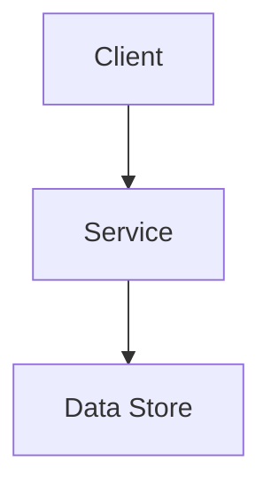

# Article Title

> Brief description of the article.

## Overview

Explain the topic and its relevance.

## Key Concepts

Explain the important concepts.

## Detailed Explanation

Provide the detailed technical explanation.

## Examples

Include practical examples.

### Example 1

```csharp
// Code example
```

## Architecture / Diagrams

Include diagrams where useful.



## Best Practices

- List recommended practices.

## Common Pitfalls

- Document common mistakes and limitations.

## References

- [Official Documentation](https://example.com)

## Related Articles

- [Related Article](../related-article.md)
